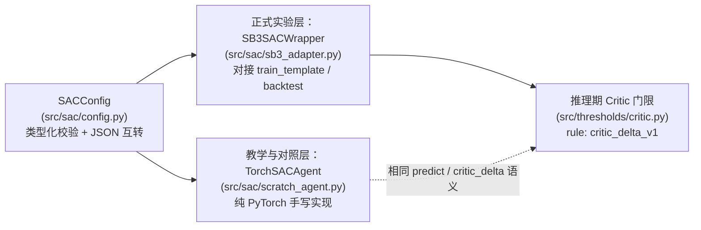

# P4 模块说明：Soft Actor-Critic (SAC) 算法与接口

> 所属角色：**P4（门限组 — SAC / TQC 与 Critic 门限）**  
> 源码路径：[src/sac/](../../src/sac/__init__.py)  
> 关联配置：[config/train_model_p4_sac_tqc.json](../../config/train_model_p4_sac_tqc.json)  
> 关联文档：[P4 总体实验方案](module_p4_sac_tqc.md)、[TQC 模块说明](module_p4_tqc.md)、[P1 接口契约 v1](../contracts/contract_p1_train_interface_v1.md)、[P2 回测更新交付 v1](../handoffs/handoff_p2_backtest_update_v1.md)

---

## 1. 模块设计目标与双层架构

根据小组实验协议，**正式基准实验（条件 `S0 / S1 / S2`）必须统一通过 `scripts/train_template.py`（基于 `stable-baselines3==2.7.1`）训练，并通过 `scripts/backtest.py` 回测**，严禁绕过公共入口提交私有训练产物；同时，课程交付成果要求清晰阐述关键算法的 MDP 形式化、网络更新机制与推理门限原理。

为此，`src/sac/` 采用**统一配置、双层实现**的模块化设计：



| 子模块 | 核心类 / 函数 | 用途定位 |
| --- | --- | --- |
| [src/sac/config.py](../../src/sac/config.py) | `SACConfig`, `parse_ent_coef_spec` | 超参数静态/动态校验，支持与 `train_model_p4_sac_tqc.json` 无损双向转换 |
| [src/sac/sb3_adapter.py](../../src/sac/sb3_adapter.py) | `SB3SACWrapper`, `build_sb3_sac`, `load_sb3_sac`, `inspect_sac_critic`, `scan_sac_critic_deltas`, `ValidationDiagnosticCallback` | **正式实验与诊断层**：封装 SB3 `SAC`、单槽经验池推理加载、验证集 Sharpe 监控回调、Critic 差值分布扫描 |
| [src/sac/networks.py](../../src/sac/networks.py) | `SquashedGaussianActor`, `TwinQCritic`, `ReplayBuffer`, `ActionScaler` | **神经网络基础组件**：重参数化 Tanh 高斯策略（含对数雅可比修正）、多头标量 Q 网络、循环经验回放池（同时供 `src/tqc/` 复用） |
| [src/sac/scratch_agent.py](../../src/sac/scratch_agent.py) | `TorchSACAgent` | **纯 PyTorch 原生实现**：完整复现 Haarnoja et al. (2018) 自动熵调节版 SAC，提供与 SB3 一致的 `.learn()` / `.predict()` / `.critic_delta()` 接口，供课程报告算法解析与白盒验证 |

---

## 2. 股票交易 MDP 形式化与 SAC 核心数学原理

### 2.1 上证 48 股（`sse48_baostock_v2`）连续动作 MDP

- **状态空间 $\mathcal{S} \subset \mathbb{R}^{481}$**：
  $$s_t = \big[\underbrace{b_t}_{1},\; \underbrace{\mathbf{p}_t}_{48},\; \underbrace{\mathbf{h}_t}_{48},\; \underbrace{\mathbf{x}_t^{(1)}, \dots, \mathbf{x}_t^{(8)}}_{48 \times 8 = 384}\big]^\top$$
  依次为账户现金 $b_t$、48 只股票前复权模拟价格 $\mathbf{p}_t$、当前持仓模拟单位 $\mathbf{h}_t$ 及 8 项技术指标（`macd`, `boll_ub`, `boll_lb`, `rsi_30`, `cci_30`, `dx_30`, `close_30_sma`, `close_60_sma`）。
- **动作空间 $\mathcal{A} = [-1, 1]^{48}$**：每个分量 $a_{t,i} \in [-1, 1]$ 经共享环境转换为整数模拟单位请求 $q_{t,i} = \operatorname{trunc}(a_{t,i} \cdot h_{\max})$（$h_{\max} = 100$），再按可交易标记 `tradable`、买卖成本（千分之一）、现金与持仓上限及 turbulence 强平规则撮合。
- **奖励函数**：$r_t = \text{reward\_scaling} \times (V_{t+1} - V_t)$，其中 $\text{reward\_scaling} = 10^{-4}$，$V_t$ 为已扣除交易手续费的组合总净值。

### 2.2 最大熵强化学习目标

SAC 在累积折扣收益之外显式最大化策略熵 $\mathcal{H}(\pi(\cdot|s_t))$，鼓励多资产连续空间中的充分探索并抑制策略过早坍缩到极端满仓/空仓边界：

$$J(\pi) = \sum_{t=0}^{T} \mathbb{E}_{(s_t, a_t) \sim \rho_\pi} \Big[ r(s_t, a_t) + \alpha \mathcal{H}\big(\pi(\cdot \mid s_t)\big) \Big]$$

其中 $\alpha > 0$ 为熵温度系数。

### 2.3 Tanh 压缩高斯策略与雅可比对数概率修正（`SquashedGaussianActor`）

由于动作严格受限于 $[-1, 1]^{48}$，Actor 输出均值 $\mu_\phi(s)$ 与对数标准差 $\log \sigma_\phi(s) \in [-20, 2]$，采用重参数化技巧采样无界高斯变量 $u \sim \mathcal{N}(\mu_\phi(s), \operatorname{diag}(\sigma_\phi^2(s)))$，再压缩为有界动作 $a = \tanh(u)$。由变量替换公式，精确对数密度为：

$$\log \pi_\phi(a \mid s) = \sum_{i=1}^{48} \left[ \log \mathcal{N}\big(u_i;\, \mu_{\phi,i}(s), \sigma_{\phi,i}^2(s)\big) - \log\big(1 - \tanh^2(u_i) + \varepsilon\big) \right]$$

推理回测阶段（`deterministic=True`）关闭采样噪声，直接输出确定性动作 $a = \tanh(\mu_\phi(s))$。

### 2.4 双 Q 网络软 Bellman 更新与过估计抑制（`TwinQCritic`）

为缓解连续控制中 Q 值函数逼近的正向过估计偏差，SAC 维护两个独立参数化的标量 Critic 网络 $Q_{\theta_1}, Q_{\theta_2}$ 及 Polyak 软更新目标网络 $Q_{\bar{\theta}_1}, Q_{\bar{\theta}_2}$。采样转移 $(s, a, r, s', d) \sim \mathcal{D}$ 及下一动作 $\tilde{a}' \sim \pi_\phi(\cdot|s')$，软 Bellman 目标为：

$$y = r + \gamma (1 - d) \left( \min_{k \in \{1,2\}} Q_{\bar{\theta}_k}(s', \tilde{a}') - \alpha \log \pi_\phi(\tilde{a}' \mid s') \right)$$

两个 Critic 最小化均方 Bellman 残差：

$$J_Q(\theta_k) = \frac{1}{2} \mathbb{E}_{(s,a,r,s',d) \sim \mathcal{D}} \Big[ \big(Q_{\theta_k}(s, a) - y\big)^2 \Big], \quad k \in \{1, 2\}$$

Actor 最小化 KL 散度等价目标：

$$J_\pi(\phi) = \mathbb{E}_{s \sim \mathcal{D},\, \tilde{a} \sim \pi_\phi(\cdot|s)} \left[ \alpha \log \pi_\phi(\tilde{a} \mid s) - \min_{k \in \{1,2\}} Q_{\theta_k}(s, \tilde{a}) \right]$$

### 2.5 自动熵温度 $\alpha$ 调节

配置 `"ent_coef": "auto_0.1"` 时，以 $\alpha_0 = 0.1$ 初始化对数温度 $\log \alpha$，默认目标熵 $\bar{\mathcal{H}} = -\dim(\mathcal{A}) = -48$，通过下式自适应更新 $\log \alpha$：

$$J(\alpha) = \mathbb{E}_{s \sim \mathcal{D},\, \tilde{a} \sim \pi_\phi(\cdot|s)} \Big[ -\log \alpha \cdot \big(\log \pi_\phi(\tilde{a} \mid s) + \bar{\mathcal{H}}\big) \Big]$$

---

## 3. 推理阶段 Critic 门限连接机制（条件 `S2`）

在回测推理阶段，对已冻结的 SAC 模型（与无门限基线 `S0` 完全同一 `.zip` 权重），比较当期确定性策略动作 $a_t = \tanh(\mu_\phi(s_t))$ 与全零动作 $\mathbf{0}$（即请求持有不动）：

$$\Delta_{\text{SAC}}(s_t, a_t) = \min_{k \in \{1,2\}} Q_{\theta_k}(s_t, a_t) - \min_{k \in \{1,2\}} Q_{\theta_k}(s_t, \mathbf{0})$$

- **判定规则（`critic_delta_v1`，`summary="min_q"`）**：
  - 若 $\Delta_{\text{SAC}}(s_t, a_t) > \tau_{\text{SAC}}$，放行原动作向量 $a_t$（`accepted = True`）；
  - 若 $\Delta_{\text{SAC}}(s_t, a_t) \le \tau_{\text{SAC}}$（含相等边界），拒绝整条动作向量并置为 $\mathbf{0}$（`accepted = False`），避免在 Critic 认为预期净优势不足以覆盖摩擦与噪声时盲目换手。
- **环境兜底**：门限不修改模型参数，也不绕过环境层的停牌限制（`tradable=False`）与市场风险强平（`turbulence`）。

---

## 4. 接口说明与代码示例

### 4.1 正式实验（命令行公共入口）

```powershell
conda activate finrl
cd "C:\Users\Haoyu Fan\PycharmProjects\FinRL\RL_Agent_Stock_Trade"

# 1. Pilot 试跑（实测耗时并生成用于验证集扫描的试跑模型）
python scripts/train_template.py `
  --config config/train_model_p4_sac_tqc.json `
  --dataset sse48_baostock_v2 `
  --algorithm sac `
  --seed 42 `
  --timesteps 20000 `
  --run-type pilot `
  --device cuda

# 2. 正式训练（冻结控制量后，运行 3 个种子）
python scripts/train_template.py `
  --config config/train_model_p4_sac_tqc.json `
  --dataset sse48_baostock_v2 `
  --algorithm sac `
  --seed 42 `
  --run-type main `
  --device cuda

# 3. 单模型无门限（S0）与 Critic 门限（S2）配对回测
python scripts/backtest.py run `
  --model trained_models/sse48_baostock_v2/sac/<MODEL>.zip `
  --data datasets/sse48_baostock_v2/val_data.csv `
  --benchmark datasets/sse48_baostock_v2/val_index.csv `
  --split validation `
  --threshold-mode none
```

### 4.2 Python 编程接口（`SB3SACWrapper` 与 Critic 扫描）

```python
from pathlib import Path
from backtest.data import DEFAULT_INDICATORS, load_market
from trading_environment import build_environment
from sac import SACConfig, SB3SACWrapper

# 1. 读取并校验 P4 配置
cfg = SACConfig.from_json("config/train_model_p4_sac_tqc.json")

# 2. 1-slot 内存安全加载训练好的 SB3 SAC 模型（避免分配 100k 训练经验池）
wrapper = SB3SACWrapper.load("trained_models/sse48_baostock_v2/sac/YOUR_PILOT_MODEL.zip", device="cpu")

# 3. 在验证集上扫描每日 critic_delta 分布，提取 0.0 / P25 / P50 / P75 候选阈值
val_df = load_market("datasets/sse48_baostock_v2/val_data.csv", DEFAULT_INDICATORS, "turbulence")
val_env = build_environment(val_df, {"hmax": 100, "initial_amount": 1_000_000,
                                     "buy_cost_pct": 0.001, "sell_cost_pct": 0.001,
                                     "reward_scaling": 1e-4, "tech_indicator_list": DEFAULT_INDICATORS,
                                     "risk_indicator_col": "turbulence", "turbulence_threshold": None,
                                     "price_basis": "adjusted_virtual_units", "tradability_policy": "enforce_column"})
report = wrapper.scan_deltas(val_env, summary="min_q")
print("Validation quantiles:", report["quantiles"])
print("Suggested candidates:", report["suggested_candidates"])
```

### 4.3 纯 PyTorch 原生版使用示例（报告对照与单步调试）

```python
from sac import SACConfig, TorchSACAgent

cfg = SACConfig(learning_rate=3e-4, buffer_size=10_000, learning_starts=200, batch_size=128)
agent = TorchSACAgent(env=val_env, config=cfg, seed=42, device="cpu")
agent.learn(total_timesteps=1_000)

obs, _ = val_env.reset(seed=0)
action, _ = agent.predict(obs, deterministic=True)
diag = agent.critic_delta(obs, summary="min_q")
print(diag)  # {'summary': 'min_q', 'critic_policy_value': ..., 'critic_zero_value': ..., 'critic_delta': ...}
```

---

## 5. SB3 封装层与 PyTorch 原生层对照表

| 维度 | `SB3SACWrapper`（基于 `stable-baselines3`） | `TorchSACAgent`（纯 PyTorch 手写） |
| --- | --- | --- |
| **适用场景** | **正式训练、门限选择与 24 次样本外测试回测** | **算法报告撰写、梯度/损失曲线剖析、白盒教学验证** |
| **策略分布** | `SquashedDiagGaussianDistribution`（$\log\sigma \in [-20, 2]$） | `SquashedGaussianActor`（同为 $\log\sigma \in [-20, 2]$ + 精确雅可比项） |
| **Critic 结构** | `ContinuousCritic`（`n_critics=2`，`[256, 256]` ReLU） | `TwinQCritic`（`n_critics=2`，`[256, 256]` ReLU） |
| **Critic 损失系数** | $0.5 \sum_{k=1}^2 \operatorname{MSE}(Q_{\theta_k}, y)$ | $0.5 \sum_{k=1}^2 \operatorname{MSE}(Q_{\theta_k}, y)$ |
| **自动熵调节** | 支持 `"auto"` / `"auto_0.1"`，$\bar{\mathcal{H}} = -\dim(\mathcal{A})$ | 同一 `parse_ent_coef_spec` 解析与损失形式 |
| **门限诊断接口** | `inspect_sac_critic` / `apply_critic_threshold` | `agent.critic_delta(obs, summary="min_q")` |
| **模型存档格式** | SB3 `.zip`（含 `metadata.txt` 数据与环境哈希） | PyTorch `.pt` 检查点（含网络、优化器与步数） |
