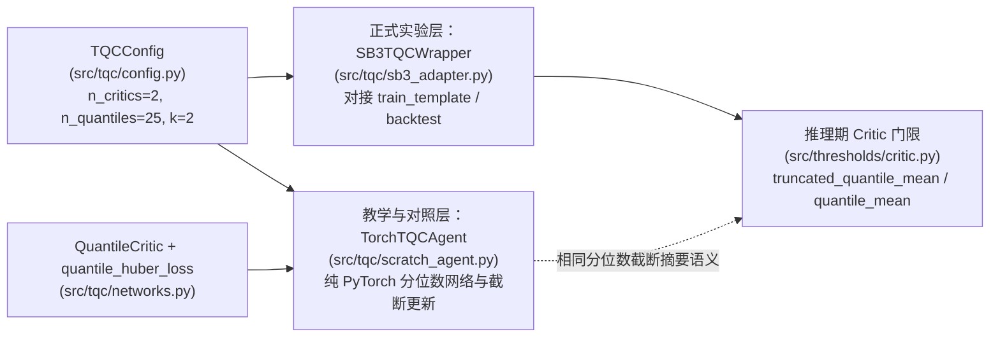

# P4 模块说明：Truncated Quantile Critics (TQC) 算法与接口

> 所属角色：**P4（门限组 — SAC / TQC 与 Critic 门限）**  
> 源码路径：[src/tqc/](../../src/tqc/__init__.py)  
> 诊断入口：[scripts/p4_critic_diagnostics.py](../../scripts/p4_critic_diagnostics.py)  
> 关联配置：[config/train_model_p4_sac_tqc.json](../../config/train_model_p4_sac_tqc.json)  
> 关联文档：[P4 总体实验方案](module_p4_sac_tqc.md)、[SAC 模块说明](module_p4_sac.md)、[P1 接口契约 v1](../contracts/contract_p1_train_interface_v1.md)、[P2 回测更新交付 v1](../handoffs/handoff_p2_backtest_update_v1.md)

---

## 1. 为什么在股票交易与 Critic 门限中引入 TQC？

在 A 股多资产（48 股）连续交易任务中，日频收益具有**低信噪比、厚尾波动与异方差性**。标准 SAC 仅对每个 Critic 预测单一标量期望 $Q_{\theta_k}(s, a)$，并通过两个网络的最小值 $\min(Q_1, Q_2)$ 抑制过估计；这带来了两方面局限：

1. **粗粒度偏差控制**：固定对 2 个点估计取最小值，无法细粒度调节悲观程度，且无法刻画回报分布的尾部不确定性。
2. **门限判定的右尾噪声放大**：当推理期使用 Critic 门限 $\Delta(s, a) = \operatorname{summary}(s, a) - \operatorname{summary}(s, \mathbf{0})$ 判断是否交易时，若未观测到的激进调仓动作在 Critic 右尾产生乐观过估计，会导致虚高的 $\Delta$ 误放行高成本噪声交易。

**TQC（Truncated Quantile Critics，Kuznetsov et al., ICML 2020）** 将“分布强化学习（分位数回归）”与“跨网络混合原子右尾截断”相结合：
- 每个 Critic 直接建模累积折扣回报的 $M$ 个分位数原子（共 $N \times M = 2 \times 25 = 50$ 个原子）；
- 计算 Bellman 目标与推理期门限价值摘要时，将所有网络的分位数原子合并升序排列，**截除最高的 $k \cdot N = 2 \times 2 = 4$ 个最乐观极端原子后取均值**，从而更稳健地过滤高方差动作的乐观偏差。

---

## 2. 模块双层架构

与 `src/sac/` 对称，`src/tqc/` 提供**正式实验封装层**（基于 `sb3-contrib==2.7.1`）与**纯 PyTorch 原生实现层**，并共享统一的超参配置与 Critic 门限协议：



| 子模块 | 核心类 / 函数 | 用途定位 |
| --- | --- | --- |
| [src/tqc/config.py](../../src/tqc/config.py) | `TQCConfig` | 校验分位数参数（`n_quantiles >= 2`、`0 <= top_quantiles_to_drop_per_net < n_quantiles`），派生 `total_quantiles=50`、`kept_quantiles=46`，与 JSON 配置互转 |
| [src/tqc/networks.py](../../src/tqc/networks.py) | `QuantileCritic`, `quantile_huber_loss`, `summarize_quantile_distribution` | 多网络分位数预测器 `(B, N, M)`、非对称 Quantile Huber Loss、分位数合并截断与 `overestimation_gap` / `IQR` / `CVaR10` 诊断 |
| [src/tqc/scratch_agent.py](../../src/tqc/scratch_agent.py) | `TorchTQCAgent` | **纯 PyTorch 原生 TQC 实现**：完整复现 Kuznetsov et al. (2020) 截断混合分位数 Bellman 备份、Actor 更新与自动熵调节 |
| [src/tqc/sb3_adapter.py](../../src/tqc/sb3_adapter.py) | `SB3TQCWrapper`, `build_sb3_tqc`, `load_sb3_tqc`, `inspect_tqc_critic`, `scan_tqc_critic_deltas`, `TQCValidationDiagnosticCallback` | **正式实验与分位数诊断层**：封装 `sb3_contrib.TQC`、单槽缓存推理加载、验证集分位数差值与截断偏差扫描 |

---

## 3. TQC 核心算法原理

### 3.1 分位数分布近似（`QuantileCritic`）

设共有 $N$ 个独立 Critic 网络（配置 `n_critics = 2`），第 $n$ 个网络输出 $M$ 个分位数原子（配置 `n_quantiles = 25`）：

$$Z_{\psi_n}(s, a) := \frac{1}{M} \sum_{m=1}^{M} \delta_{\theta_n^{(m)}(s, a)}$$

对应中点分位水平为 $\tau_m = \frac{m - 0.5}{M}$（$m = 1, \dots, M$）。

### 3.2 跨网络原子池化与右尾截断目标

给定经验样本 $(s, a, r, s', d) \sim \mathcal{D}$，由当前策略重参数化采样下一动作 $\tilde{a}' \sim \pi_\phi(\cdot \mid s')$。将 $N$ 个目标网络 $Z_{\bar{\psi}_1}, \dots, Z_{\bar{\psi}_N}$ 在 $(s', \tilde{a}')$ 处输出的共 $N \cdot M$ 个原子汇入同一集合并升序排列：

$$z_{(1)}(s', \tilde{a}') \le z_{(2)}(s', \tilde{a}') \le \dots \le z_{(NM)}(s', \tilde{a}')$$

设每个网络截除最高分位数个数为 $k$（配置 `top_quantiles_to_drop_per_net = 2`），则总保留原子数为 $K = (M - k)N = (25 - 2) \times 2 = 46$。仅用最小的 $K$ 个原子构造软分布 Bellman 目标原子：

$$y_j = r + \gamma (1 - d) \Big( z_{(j)}(s', \tilde{a}') - \alpha \log \pi_\phi(\tilde{a}' \mid s') \Big), \quad j = 1, \dots, K$$

### 3.3 非对称 Quantile Huber Loss（`quantile_huber_loss`）

对每个在线网络 $n \in \{1, \dots, N\}$ 的第 $m$ 个预测分位数 $\theta_n^{(m)}(s, a)$ 与目标原子 $y_j$，定义成对 TD 残差 $\Delta_{nmj} = y_j - \theta_n^{(m)}(s, a)$，采用平滑阈值 $\kappa = 1$ 的非对称分位数 Huber 损失：

$$\rho_{\tau_m}^{\kappa}(\Delta) = \big| \tau_m - \mathbb{I}(\Delta < 0) \big| \cdot \frac{\mathcal{L}_\kappa(\Delta)}{\kappa}, \qquad \mathcal{L}_\kappa(\Delta) = \begin{cases} \frac{1}{2}\Delta^2, & |\Delta| \le \kappa \\ \kappa\big(|\Delta| - \frac{1}{2}\kappa\big), & |\Delta| > \kappa \end{cases}$$

总 Critic 损失对目标原子数 $K$ 取平均，对分位数维 $M$ 与网络维 $N$ 求和：

$$J_Z(\psi) = \mathbb{E}_{(s,a,r,s',d) \sim \mathcal{D}} \left[ \sum_{n=1}^{N} \sum_{m=1}^{M} \frac{1}{K} \sum_{j=1}^{K} \rho_{\tau_m}^{\kappa}\big(y_j - \theta_n^{(m)}(s, a)\big) \right]$$

### 3.4 Actor 与温度 $\alpha$ 更新

依照原论文式 (11) 与 `sb3-contrib` 实现，Actor 在策略改进时最大化在线网络全部 $N \cdot M$ 个分位数的均值（过估计已在 Critic 训练目标阶段被抑制，避免双重截断导致过度保守）：

$$J_\pi(\phi) = \mathbb{E}_{s \sim \mathcal{D},\, \tilde{a} \sim \pi_\phi(\cdot|s)} \left[ \alpha \log \pi_\phi(\tilde{a} \mid s) - \frac{1}{NM} \sum_{n=1}^{N} \sum_{m=1}^{M} \theta_n^{(m)}(s, \tilde{a}) \right]$$

熵温度 $\alpha$ 更新规则与 SAC 完全一致（`ent_coef = "auto_0.1"`，$\bar{\mathcal{H}} = -48$）。

---

## 4. SAC 与 TQC 对照及 Critic 门限（条件 `T2`）

### 4.1 受控实验设计对照

在 [config/train_model_p4_sac_tqc.json](../../config/train_model_p4_sac_tqc.json) 中，SAC 与 TQC 的学习率（`3e-4`）、批量（`256`）、回放池（`100000`）、`learning_starts`（`1000`）、网络宽度（`[256, 256]`）、Critic 个数（`2`）与初始温度（`auto_0.1`）**严格一致**，使 `S0 vs T0` 与 `S2 vs T2` 的差异完全归因于**标量双 Q vs 截断分位数分布 Critic**：

| 对比项 | SAC（`S0 / S1 / S2`） | TQC（`T0 / T1 / T2`） |
| --- | --- | --- |
| **Critic 输出张量** | 2 个标量 `(B, 2)` | $2 \times 25$ 个分位数 `(B, 2, 25)` |
| **损失函数** | 均方误差 MSE | 非对称 Quantile Huber Loss ($\kappa=1$) |
| **过估计控制** | 2 个标量取 $\min(Q_1, Q_2)$ | 50 个分位数升序池化，截掉最高 4 个取前 46 个均值 |
| **默认门限摘要（`critic_delta_v1`）** | `summary = "min_q"` | `summary = "truncated_quantile_mean"` |
| **备选对照摘要** | `summary = "mean_q"` | `summary = "quantile_mean"`（不截断全均值） |
| **特有分布诊断量** | 双 Q 极差 `policy_critic_spread` | 截断偏差 `overestimation_gap`、四分位距 `iqr`、左尾 `cvar10` |

### 4.2 TQC 推理期 Critic 门限公式（条件 `T2`）

对同一已冻结 TQC 模型，在状态 $s_t$ 下记池化升序分位数为 $z_{(1)}(s_t, a) \le \dots \le z_{(50)}(s_t, a)$，默认截断分位数均值摘要定义为：

$$\bar{Z}_{\text{trunc}}(s_t, a) = \frac{1}{46} \sum_{j=1}^{46} z_{(j)}(s_t, a)$$

门限判定量为：

$$\Delta_{\text{TQC}}(s_t, a_t) = \bar{Z}_{\text{trunc}}(s_t, a_t) - \bar{Z}_{\text{trunc}}(s_t, \mathbf{0})$$

仅当 $\Delta_{\text{TQC}}(s_t, a_t) > \tau_{\text{TQC}}$ 时放行整向量动作 $a_t$；否则置零拒绝（`accepted = False`）。

---

## 5. 接口说明与诊断工具用法

### 5.1 正式实验与回测命令

```powershell
conda activate finrl
cd "C:\Users\Haoyu Fan\PycharmProjects\FinRL\RL_Agent_Stock_Trade"

# 1. TQC Pilot 试跑
python scripts/train_template.py `
  --config config/train_model_p4_sac_tqc.json `
  --dataset sse48_baostock_v2 `
  --algorithm tqc `
  --seed 42 `
  --timesteps 20000 `
  --run-type pilot `
  --device cuda

# 2. 使用 P4 诊断脚本扫描 pilot 模型在验证集上的 critic_delta 分位数（自动拦截测试集！）
python scripts/p4_critic_diagnostics.py scan `
  --model trained_models/sse48_baostock_v2/tqc/<PILOT_MODEL>.zip `
  --data datasets/sse48_baostock_v2/val_data.csv `
  --output results/p4_diagnostics/tqc_pilot_val_scan.json

# 3. 正式训练（冻结控制量后，运行 3 个种子）
python scripts/train_template.py `
  --config config/train_model_p4_sac_tqc.json `
  --dataset sse48_baostock_v2 `
  --algorithm tqc `
  --seed 42 `
  --run-type main `
  --device cuda

# 4. 一键对比 SB3/sb3-contrib 封装版与纯 PyTorch 手写版（合成环境自检）
python scripts/p4_critic_diagnostics.py compare-impl --algorithm both --timesteps 32
```

### 5.2 Python 编程接口（`SB3TQCWrapper` 与 `TorchTQCAgent`）

```python
from tqc import SB3TQCWrapper, TQCConfig, TorchTQCAgent

# 1. 加载 sb3-contrib TQC 正式模型并检查单步分位数诊断
wrapper = SB3TQCWrapper.load("trained_models/sse48_baostock_v2/tqc/<MODEL>.zip", device="cpu")
diag = wrapper.inspect_critic(obs)
print("Truncated delta:", diag["delta_truncated_quantile_mean"])
print("Overestimation gap stripped by TQC:", diag["overestimation_gap_policy"])
print("Return distribution IQR:", diag["iqr_policy"])

# 2. 纯 PyTorch 原生版 TQC（用于报告解析与分布实验）
cfg = TQCConfig.from_json("config/train_model_p4_sac_tqc.json")
agent = TorchTQCAgent(env=train_env, config=cfg, seed=42, device="cpu")
agent.learn(total_timesteps=2_000)
print(agent.critic_delta(obs, summary="truncated_quantile_mean"))
```
