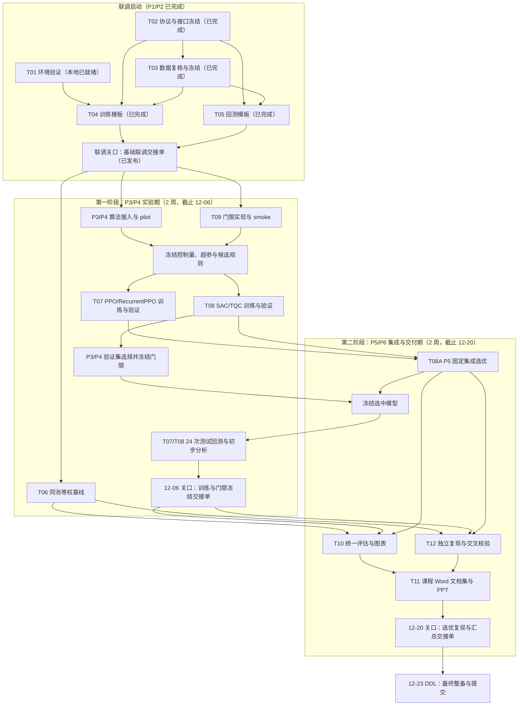

# 基于 FinRL 的强化学习股票交易 Agent 小组项目计划

**版本**：v2.1（联调就绪、两阶段执行与作业交付规划）  
**关键节点**：前两周实验截止 **12 月 6 日**；后两周集成与总结截止 **12 月 20 日**；项目完整提交 DDL **12 月 23 日**  
**团队规模**：6 人，角色编号 P1–P6  
**前置基础**：PyTorch、强化学习基础  
**训练方式**：本地与云算力结合  
**文档状态**：组内执行计划；数据指纹、算法配置、门限参数及训练预算按下列安排核验和冻结。

本计划基于历史版本演进修订（历史版本通过 Git 追溯，工作区仅保留本现行版）。当前数据与回测细节分别见 [SSE48 数据说明](modules/module_data_sse48.md) 和 [统一回测框架说明](modules/module_backtest.md)。

---

## 1. 问题、文献基础与实验基准

### 1.1 问题定义

股票交易是序贯决策问题。智能体观察账户与市场状态，提出买入、卖出或持有动作，并依据组合价值变化获得奖励。本项目使用 FinRL 股票环境研究和比较不同策略。

- **状态**：现金、各资产价格和持仓，以及技术指标；当前 48 股、八项指标口径下为 481 维，以实际冻结配置为准。
- **动作**：模型对每个资产输出连续 Box 动作，当前环境乘以 `hmax` 后向零取整，再按资金、持仓、可交易状态及风险规则执行。整数是复权模拟单位，不是交易所真实股数。
- **奖励**：当前环境使用相邻时点组合价值变化乘以 `reward_scaling`；成交费用已影响账户价值。正式实验以共享环境和冻结配置为准，不擅自为单个算法更改奖励。
- **约束**：模拟包含买卖成本、资金/持仓限制及配置指定的可交易、风险规则；如启用 turbulence，将其作为市场风险门控。

### 1.2 研究问题

1. **记忆对照**：PPO 与 RecurrentPPO 在相同数据、观测、环境和训练协议下，表现和交易行为有何差异？
2. **门限对照**：对同一个已训练 SAC 或 TQC 模型，在推理阶段增加简单动作门限或 Critic 门限后，交易行为和净表现有何变化？Critic 门限是否优于简单规则？
3. **固定集成选优**：复用主实验候选模型，仅根据验证期 Sharpe 选择一个模型，冻结后评估其样本外表现。

第二项是主要创新实验；第一项为补充算法对照。Critic 门限用于推理阶段的策略后处理，固定集成选优采用一次验证集模型选择。

### 1.3 范围与不做事项

- 以统一回测中的策略比较为目标，保留失败和负面结果。
- DDPG、TD3 移出必做，但保留已有代码和结果；A2C 门限的重新设计与实验暂不实施。
- 本轮开展数据质量检查，数据扰动训练与可靠性门控暂不纳入。
- 动态滚动重训、MVO/最小方差和进一步门限研究为可选，仅在核心工作及资源允许时启动。

### 1.4 文献简述与小组开发界定

本项目以开源框架 FinRL 及其核心论文为研究基础，在此之上完成面向 A 股场景的数据工程、算法扩展、推理门限与统一回测开发：

- **他人工作基础（FinRL 论文与上游库）**：Liu 等人（2020/2022）提出了面向自动化股票交易的三层模块化强化学习库 FinRL（市场环境层、智能体层、应用层）[^1]，基于 Gym 接口封装多资产连续交易环境，内建交易手续费、`hmax` 仓位流动性约束与 turbulence 风险控制，并集成 Stable Baselines3 标准 DRL 算法（PPO、DDPG、TD3、SAC、A2C 等）及基础回测流程。同系列研究（Yang 等人，2020）进一步提出了基于验证集 Sharpe 指标的动态滚动重训集成策略框架[^2]。上游 FinRL v0.3.8 仓库提供了基础环境基类、技术指标计算与示例脚本[^3]。
- **本小组开发工作内容**：
  1. **A 股可复现数据流水线**：构建 `sse48_baostock_v2` 数据工程（`src/data_pipeline/`），实现 BaoStock 行情拉取与本地缓存、前复权校验、停牌及可交易状态过滤、技术指标计算与 SHA256 数据指纹冻结。
  2. **统一训练框架与算法扩展**：设计配置驱动的训练模板（`src/train_model/`、`scripts/train_template.py`），在现有算法基础上扩展集成 `sb3-contrib` 的 `RecurrentPPO`（含 LSTM 隐藏状态传递与跨回合重置）与 `TQC`，并实现训练元数据、代码/数据哈希及运行清单自动追踪。
  3. **推理阶段交易拒绝门限（主要创新）**：在不修改训练期奖励与共享环境源码的前提下，设计并实现推理期策略后处理门限接口，支持逐资产简单动作幅度门限与整向量 Critic 价值差门限的受控对比实验。
  4. **统一回测与固定集成选优**：构建独立可复现的回测框架（`src/backtest/`、`scripts/backtest.py`），支持多条件配对回测、门限拒绝率与换手诊断、同池等权与指数基线对照，以及区别于原论文动态重训的“一次固定验证集 Sharpe 选优”。

### 1.5 数据基准与共享环境

主实验使用 `sse48_baostock_v2` 数据集，使用 BaoStock 行情、交易状态和复权因子，股票池为 2016 年初上证 50 名单排除两只后的固定 48 股，八项技术指标在本地计算。

| 子集 | 实际交易日 | 用途 |
| --- | --- | --- |
| 训练 | 2017-01-16 至 2020-12-31 | 模型训练，包含指标预热后的数据 |
| 验证 | 2021-01-04 至 2022-12-30 | 有限配置检查、门限选择、固定集成选优 |
| 测试 | 2023-01-03 至 2026-11-03 | 参数和选中模型冻结后的最终样本外评价 |

训练、验证和测试保持严格独立；测试绩效仅用于最终评价。市场阶段采用数据配置中既有的指数 60 日收益、上下 5% 阈值和连续 20 个交易日规则；若测试区间不足以支持某阶段的连续分析，改报告预先登记的压力案例，不根据策略测试结果重贴标签。

训练和回测复用同一共享环境、股票及指标顺序、复权价格、初始资金、交易成本、`tradable` 策略、风险阈值与 `hmax`。当前回测以同日复权收盘信息决策并按同收盘价成交、下一日估值，最终报告须说明其可能偏乐观，并列明 T+1、涨跌停排队、整手、滑点和公司行为结算等未模拟的交易限制。

---

## 2. 统一实验协议

### 2.1 模型与条件

| 条件 | 训练模型 | 推理执行 | 目的 |
| --- | --- | --- | --- |
| P0 | PPO | 无门限 | 普通 PPO 基线 |
| P1 | RecurrentPPO | 无门限 | 比较循环记忆；此处 P1 是实验条件，不是成员编号 |
| S0 | SAC | 无门限 | SAC 基线 |
| S1 | 与 S0 同一 SAC 模型 | 简单动作门限 | 简单过滤对照 |
| S2 | 与 S0 同一 SAC 模型 | Critic 门限 | 门限实验 |
| T0 | TQC | 无门限 | TQC 基线 |
| T1 | 与 T0 同一 TQC 模型 | 简单动作门限 | 简单过滤对照 |
| T2 | 与 T0 同一 TQC 模型 | Critic 门限 | 门限实验 |

- 四算法使用相同三个预先冻结的种子，共 **12 次正式训练**；每个“算法—种子”只有一个事先登记的主配置。
- 固定测试集共 **8 个条件 × 3 种子 = 24 次策略回测**。S0/S1/S2 和 T0/T1/T2 各自复用同算法、同种子、同一模型文件，仅改变推理规则，不重新训练。
- 集成选优不新增训练，选中模型的无门限测试结果复用 24 次之一，不额外计数；独立重跑另行登记。验证集候选回测、pilot、失败重试、非 DRL 基线及独立复现均不计入 24 次。
- 模型及条件使用相同数据、环境、成本、时间边界和预先冻结的交互步数预算。PPO 类 rollout 可能使实际步数超过请求值；记录实际步数、设备、耗时和资源，不假设不同算法计算成本相同。
- 门限改变交易后，后续持仓和状态也会改变；这是同模型配对回测，不是逐日相同状态的反事实比较。

P3、P4 共同确定并登记控制量（数据、环境、成本、三个种子、交互步数预算），分别确定各自负责算法的特殊训练超参数及门限参数：P3 负责 PPO、RecurrentPPO 与简单门限，P4 负责 SAC、TQC 与 Critic 门限。训练配置校验按当次启动算法检查，支持 P3/P4 分别交付配置。

### 2.2 简单动作幅度门限

P3 按公共接口契约实现并自测。对每个资产，沿用环境相同的数据类型和计算路径，计算 `q_i = trunc(a_i * hmax)`：若 `abs(q_i) < q_min`，则将该资产动作置零，否则保留原动作。`trunc` 为向零取整；`q_min=1` 不增加实质过滤，因为原环境已将不足一个模拟单位的动作取整为零。

候选 `q_min ∈ {2, 5, 10}` 作为制定选择协议的起点。P3 确定候选范围及实现，P3/P4 共同确定统一验证指标、并列与无效值处理规则，P2 核验指标。SAC/TQC 共用的简单门限由 P3/P4 按登记规则在验证集选择；正式规则在训练前登记。

门限逐资产执行，环境仍最终处理资金、持仓、停牌和风险强平；不能以门限屏蔽强制风险规则。临界值和负动作须按真实浮点及取整路径测试。

### 2.3 Critic 门限

P4 按公共接口契约实现 SAC/TQC 门限。门限仅在推理时使用：以相同状态、相同动作尺度和相同摘要规则比较策略动作 `a` 与零动作 `0`：

`delta = summary(s, a) - summary(s, 0)`。

最小方案对两侧使用相同汇总规则：SAC 使用预先定义的标量 Critic 摘要，TQC 使用预先定义的分位数均值摘要；当 `delta` 不超过冻结阈值时拒绝完整动作向量。P4 在正式训练前登记摘要、候选范围、相等边界、禁用行为及无效数值处理，并在验证集选择最终阈值；SAC 和 TQC 不要求阈值数值相同。

- Critic 门限拒绝整向量，简单门限逐资产过滤；分析时结合两者作用粒度的差异。
- 两侧动作采用相同的预处理和 Critic 聚合；分析时关注零动作的数据覆盖及 Critic 估计误差。
- 当前奖励已反映成本，阈值受奖励缩放和回报尺度影响；风险规则可能覆盖零动作并产生实际成交。
- Critic 分歧、分布距离、逐资产反事实门限及训练时启用门限属于可选研究，不属于本轮最小实现。

### 2.4 验证选择与测试隔离

正式训练前，P3/P4 确定并版本化门限候选、选择指标、并列和无效结果规则；P2 提供统一指标契约，P5 留存选择记录。候选数应有限；验证指标为 Sharpe 时，收益区间不足或波动为零导致的 `null` 不能当作零，须按预先登记规则处理。

正式模型训练完成后（12 月 6 日前），P3/P4 在验证集执行已登记的候选选择，分别冻结简单门限及 SAC/TQC Critic 门限。记录所有候选和结果、选择规则、模型/数据哈希及最终参数；无法按规则选出时登记失败，不使用测试集补选。所有策略测试回测开始前，门限及第 2.5 节选中模型必须冻结。

### 2.5 P5 固定验证集集成选优

P5 主责一次固定验证集选优：

1. 复用 PPO、RecurrentPPO、SAC、TQC 的 **12 个无门限正式模型**（P0、P1、S0、T0 各三个种子），不把门限变体额外计为候选。
2. 使用相同验证数据和统一 Sharpe 口径，按预先登记的有效值、并列与无效结果规则选出一个模型。保存所有候选、种子、验证指标、模型/数据哈希及选择原因；无法按规则选出时登记失败，不根据测试表现补选。
3. 在任何策略测试回测前冻结选中模型，复用其 24 次主回测中的无门限结果；完全相同配置下为复现重跑时另行登记。
4. 与单算法逐种子结果及非 DRL 基线比较，报告选中模型的一条测试轨迹，并说明跨算法及种子选优的验证集选择偏差。

### 2.6 非 DRL 基线与指标

- **核心基线**：同池等权买入持有，明确初始建仓、成本、停牌和未成交现金处理；与策略使用相同测试区间及统一指标。
- **外部参照**：上证 50 指数 `sh.000016`（价格指数不含分红再投资、不扣交易费用，与固定 48 股池不完全等价，单独披露）。
- **可选基线**：MVO 或最小方差；须事先冻结估计窗口、调仓、费用和约束，不挤占核心实验。

P3/P4 交付同池等权基线，P2 核验口径并提供指数及统一评价接口。核心指标为期末资产、累计和年化收益、年化波动、最大回撤和 Sharpe；补充诊断包括成交次数、累计费用、`gross_turnover`（累计买卖成交金额除以初始资本）、持仓、风险暴露及门限拒绝比例。

---

## 3. 开发方式、公共规则与阶段交接

### 3.1 上游契约与全组协作规则

全组采用“**上游先发布契约，下游实现、自测和异步反馈**”的协作模式，减少例行讨论，保证多机并行开发的一致性：

| 上游职责 | 发布的公共契约 | 下游消费方 |
| --- | --- | --- |
| 数据与回测规范（P2） | SSE48 数据版本与哈希、共享环境口径、成交/对账与统一指标定义 | 全员（P1 训练接入、P3/P4 基线与门限、P5 选优、P6 汇总）均遵守 |
| 训练与模型规范（P1） | 新算法与门限的公共接入口、参数透传、循环状态传递/重置及元数据规范 | P3/P4 接入算法与门限；P5 消费模型产物与验证清单 |
| 验证与选优输入（P2/P5） | 验证期账户曲线、Sharpe 口径、选优记录与复现抽查清单 | P3/P4 登记门限选择；P5 执行固定选优；P6 统一汇总 |

负责人先完成自测并提交结果，下游通过问题记录异步反馈；上游修订版本并同步通知受影响成员。若数据口径、实验预算、门限选择规则或已冻结协议发生冲突，须升级确认并重新冻结。

### 3.2 环境依赖、公共入口与追踪规范

- **权威依赖**：全组统一使用 `requirements-lock.txt`（Windows / Python 3.9.13、`stable_baselines3==2.7.1`、`sb3_contrib==2.7.1`、`torch==2.8.0+cu126`）。云端或新机器启动前须先完成依赖核验与基础冒烟测试，不得静默升级或替换核心依赖。
- **公共运行入口**：训练统一调用 `scripts/train_template.py`，回测统一调用 `scripts/backtest.py`；接口规范见 [P1 接口契约](contracts/contract_p1_train_interface_v1.md) 与 [统一回测框架说明](modules/module_backtest.md)。
- **参数与运行隔离**：按当次启动算法校验配置，严格区分 `smoke`、`pilot`、`main` 三类运行，严禁将测试集用于训练、调参或选优。
- **全链路哈希追踪**：所有正式运行须自动记录数据集、共享环境源码、门限实现源码的 SHA256 哈希，以及模型 `metadata.txt`、`run_manifest.json`、设备、耗时和实际步数。同条件重复运行不得计作额外种子。
- **产物管理**：训练产物（`trained_models/`、`results/`、`tensorboard_log/`、`datasets/`）按 `.gitignore` 规则本地保存，不直接入库；交接时通过清单与哈希核验。

### 3.3 阶段交接与独立交接单

各阶段交接不内嵌于本计划正文，**均须单独编写阶段交接单文档**（统一存放于 `docs/handoffs/`，命名格式 `handoff_<阶段或角色>_v<N>.md`），记录交付清单、文件与模型哈希、自测结果、已知问题及验收确认：

1. **联调启动交接（已完成）**：P1/P2 已完成基础编码、单元测试与端到端接口联调，冻结数据契约、训练/回测公共入口与门限调用接口，并出具 [基础联调交接单 v1](handoffs/handoff_s0_baseline_integration_v1.md) 移交 P3/P4 进入第一阶段。
2. **第一阶段结束交接（12 月 6 日前）**：P3/P4 完成算法接入、pilot、12 次正式训练、验证集门限选择与 24 次测试回测后，出具《实验训练与门限冻结交接单》，向 P5/P6 移交 12 个无门限候选模型、门限冻结参数、测试结果与初步分析。
3. **第二阶段结束交接（12 月 20 日前）**：P5 完成固定集成选优与独立复现核验，P6 完成统一评估与汇总材料后，出具《选优复现与汇总交接单》，进入最终整备与提交。

### 3.4 项目结构与目录约定

> **注意**：仓库完整目录树见根目录 [README.md](../README.md) 的“项目结构”节，**随项目开发持续更新**。

- **`src/`（模块化源码）**：按功能建子目录放置核心源码（`data_pipeline/`、`train_model/`、`backtest/`、`thresholds/`、`baselines/`、`ensemble/`、`evaluation/`；共享环境 `trading_environment.py` 暂留 `src/` 根目录，后续新增模块一律建子目录）。
- **`scripts/`（可执行入口）**：仅放置可直接作为入口运行的 `.py` / `.ps1` 脚本，不放置 Markdown 说明文档。
- **`docs/`（文档分层归档）**：根目录仅保留唯一现行版 `小组项目计划.md`（历史版本通过 Git 追溯）；其余文档按三类英文子目录存放：
  - `docs/modules/`：模块说明（命名 `module_<模块名>.md`）；
  - `docs/contracts/`：接口契约（命名 `contract_<角色或主题>_v<N>.md`）；
  - `docs/handoffs/`：阶段交接说明（命名 `handoff_<阶段或角色>_v<N>.md`）。

---

## 4. 开发任务、进度规划与节点图

### 4.1 任务分工表

> **当前进度基线**：T01–T05 的核心编码、单元测试与 S0 基础联调已完成（《基础联调交接单 v1》已发布），正式移交 P3/P4 启动第一阶段实验。

| 任务 | 工作内容与交付 | 主责 / 协作 |
| --- | --- | --- |
| T01 环境验证 | 本地/云端依赖、设备、安装及短流程；兼容记录 | P1 基础验证（已就绪）；P3/P4 验证各自算法与云端环境 |
| T02 协议和接口 | 数据与公共接口契约，登记控制量、特殊配置、门限选择规则与交接单 | P1/P2 发布公共契约；P3/P4 确定实验参数；P5 留存选优记录 |
| T03 数据 | 复核并冻结 SSE48 数据、哈希、时序、资产身份与指数 | P2；P1 核验 |
| T04 训练模板 | 算法接入口、配置透传、保存/加载及验证接口；接入并验证新算法 | P1 公共接口（已编码自测）；P3/P4 接入各自算法 |
| T05 回测模板 | 条件身份、门限接入、LSTM 回放、对账、指标和汇总 | P2（已编码自测）；P1/P3/P4 按契约联调 |
| T06 基线 | 同池等权买入持有及指数接入、口径与结果核验 | P3/P4；P2 核验 |
| T07 记忆组 | 接入 `RecurrentPPO`、配置与 pilot，完成 PPO、RecurrentPPO 各三种子训练、验证、测试及分析 | P3；P1/P2 联调支持 |
| T08 门限组 | 接入 `TQC`、配置与 pilot，完成 SAC、TQC 各三种子及三条件配对回测与分析 | P4；P1/P2 联调支持 |
| T09 门限实现 | 确定候选及选择规则，实现两类门限、测试并在验证集选定参数 | P3 简单门限；P4 Critic 门限；P2 核验，P5 留存记录 |
| T08A 固定集成选优 | 12 个无门限候选验证期 Sharpe 选优、冻结与样本外结果 | P5；P1/P2 核验模型与指标，P3/P4 交接候选 |
| T10 统一评估 | 逐种子、配对、阶段/压力案例和交易行为汇总 | P6；P2–P5 核对 |
| T11 报告与 PPT | 研究问题、实验、结果、课程作业 Word 文档集与演示 PPT | P6 统筹；P1–P5 按作业分工编写对应章节 |
| T12 独立复现 | 抽查数据、模型、门限配对、固定选优和结果来源 | P5；各成员先自测，P2 交叉核验 P5 选优 |

### 4.2 阶段进度安排

| 阶段与时间 | 主要工作 | 阶段交付与关口 |
| --- | --- | --- |
| **联调启动** （已完成） | P1/P2 完成训练与回测模板联调、账户对账及数据指纹冻结；向 P3/P4 移交公共入口与契约 | 《基础联调交接单 v1》已发布；数据、环境与公共接口正式冻结 |
| **第一阶段：P3/P4 实验期** （2 周，**12 月 6 日截止**） | **第 1 周**：P3/P4 接入 `RecurrentPPO`/`TQC` 与两类门限，完成 smoke/pilot 与同池等权基线；共同冻结控制量、超参及门限规则，启动 12 次正式训练。 **第 2 周**：完成 12 次正式训练与验证；P3/P4 在验证集选定并冻结门限；待 P5 冻结选中模型后，完成 24 次测试回测与初步分析 | **12 月 6 日关口**：《实验训练与门限冻结交接单》；12 个正式模型、门限冻结记录、24 次测试结果与初步分析齐备 |
| **第二阶段：P5/P6 集成与交付期** （2 周，**12 月 20 日截止**） | **第 1 周（可与 P3/P4 第 2 周并行准备）**：P5 搭建选优与复现脚本，待 12 个无门限模型就绪后立即执行固定集成选优并冻结选中模型；P6 搭建统一评估表与报告框架。 **第 2 周**：P5 完成独立抽查与交叉复现；P6 汇总全组实验结果、图表，统筹完成课程要求的 Word 文档集、PPT 与总结 | **12 月 20 日关口**：《选优复现与汇总交接单》；独立复现报告、统一评估汇总、全套课程文档初稿与 PPT 完成 |
| **最终整备与提交** （12 月 21 日—**12 月 23 日 DDL**） | 全员交叉校对 Word 文档、截图、源程序说明与 PPT，演练汇报并打包提交至指定邮箱 | **12 月 23 日 DDL**：全部成果定稿提交 |

### 4.3 任务依赖与进度节点图

### 4.4 全员交付责任

各成员须提交可重新计算的原始结果、数据及配置版本、运行日志、绘图程序与表格、本人初步分析、失败案例和自测复现记录；收到口径或复现问题后由原负责人修复。P5 独立抽查不能代替自测；P6 汇总时不得筛掉负面结果。

---

## 5. 工作量估计

### 5.1 代码量估算

| 类别 | 模块/内容 | 代码规模（Python 及脚本/测试） |
| --- | --- | --- |
| **已完成基础代码（P1/P2）** | `src/` 核心模块（`data_pipeline`、`train_model`、`backtest`、`trading_environment`）约 1,636 行；`scripts/` 约 656 行；新增/扩展单元测试约 693 行；FinRL 适配约 25 行 | 约 **3,000 行** |
| **待完成增量代码（P3–P6）** | 简单门限与 Critic 门限正式实现、算法接入配置与自测、同池等权基线、P5 固定选优与复现核验脚本、P6 统一评估汇总与绘图脚本 | 约 **1,200–1,800 行** |
| **合计** | 小组自研与扩展代码总量（不含上游 FinRL 源码与文档） | 约 **4,200–4,800 行** |

### 5.2 人天估算

| 角色 / 阶段 | 主要投入内容 | 估算人天 |
| --- | --- | --- |
| **P1 / P2**（前期开发 + 后续联调与支持） | 环境锁、数据流水线、训练/回测模板、接口契约、联调支持与交叉核验 | 20–26 人天 |
| **P3 / P4**（2 周实验期，截止 12 月 6 日） | 算法接入、门限实现与自测、smoke/pilot、12 次正式训练、验证选优、24 次测试回测与分析（每人 12–16 人天） | 24–32 人天 |
| **P5 / P6**（2 周交付期，截止 12 月 20 日） | 固定选优、独立复现抽查、统一评估汇总、图表生成、课程 Word 文档集与 PPT（每人 10–14 人天） | 20–28 人天 |
| **合计** | 6 人小组全周期有效投入（平均约 11–14 人天/人） | **64–86 人天** |

### 5.3 算力与 GPU 机时估算

以单张主流消费级/云端 GPU（如 RTX 3090/4090 同级算力）为估算基准，最终预算以第 1 周 pilot 实测耗时为准校准：

- **正式训练（12 次）**：
  - `PPO` 与 `RecurrentPPO`（各 3 种子，共 6 次，含 LSTM 序列前向/反向传播）：约 **8–18 GPU 小时**。
  - `SAC` 与 `TQC`（各 3 种子，共 6 次，off-policy 经验回放与 Critic 梯度更新）：约 **6–14 GPU 小时**。
- **调试与重跑冗余**：smoke、pilot 参数校准及异常重试预留：约 **6–10 GPU 小时**。
- **回测与门限扫描**：验证集门限扫描、24 次测试回测及基线评估主要消耗 CPU，约 **2–4 CPU 核小时**。
- **合计 GPU 机时**：预计 **20–42 GPU 小时**。

---

## 6. 课程作业交付文档划分

> **备注**：本节文档**暂不开始写作**，待课程提供案例或模板后再启动编写与统稿。

依据课程作业要求，需提交以下 8 项成果（其中第 1、2、3、4、6、8 项为 **Word** 格式，第 7 项为 **PPT** 格式，第 5 项为**源程序与程序说明**）。全组按下列分工编写并由 P6 统稿：

| 作业要求条目 | 提交格式 | 主责人 | 协作与素材来源 | 核心内容 |
| --- | --- | --- | --- | --- |
| 1. 系统需求（数据、功能、质量属性） | Word | **P1** | P2（数据/质量需求）、P6（统稿格式） | 问题定义、SSE48 数据需求、训练/门限/回测功能需求、可复现性与隔离等质量属性 |
| 2. 数据设计 | Word | **P2** | P1（训练读取校验） | BaoStock 数据源、SSE48 成分股筛选、前复权与停牌处理、8 项指标、train/val/test 划分与 SHA256 指纹 |
| 3. 系统总体设计方案 | Word | **P1** | P2（回测架构）、P6（统稿） | 基于 FinRL 的三层扩展架构、模块划分、公共接口与配置设计、推理门限插拔机制 |
| 4. 系统的关键算法 | Word | **P3 / P4** | P5（固定选优逻辑）、P1（算法接入口） | MDP 形式化；P3 负责 PPO vs RecurrentPPO（LSTM 状态）；P4 负责 SAC/TQC 与 Critic/简单门限；P5 补充验证集选优规则 |
| 5. 系统的源程序及程序说明 | 代码 + 说明 | **P1 / P2** | P3–P5 提交各自模块源码与使用说明 | 完整代码仓库、`README.md`、环境脚本、训练/回测/选优/绘图说明及单元测试 |
| 6. 系统运行结果（输入/中间处理/输出截图） | Word | **P6** | P2–P5 提供各自模块原始截图与日志 | 数据准备截图、训练过程（TensorBoard/日志）截图、门限过滤中间日志、24 次回测与基线对比图表 |
| 7. 项目介绍演示文件 | PPT | **P6** | 全员提供核心图表与结论页素材 | 研究问题、创新点（门限与记忆对照）、实验结果、失败/局限分析与汇报演练 |
| 8. 小组总结与个人总结 | Word | **P6（小组总结） 全员（个人总结）** | P1–P6 每人提交个人总结 | 小组协作过程、经验教训、降级与复现总结；P1–P6 各自承担工作、收获与反思 |

---

## 7. 评估、验收与风险控制

### 7.1 统一评估与测试

- 报告各算法、各条件逐种子结果与均值±标准差；门限组报告同模型逐种子配对差值、拒绝比例和交易行为。三个种子仅支持描述性比较，不作强显著性推断。
- 分别比较 Critic 门限、简单门限与无门限；披露逐资产过滤和整向量拒绝的差异。单独报告固定选优的候选、验证指标、选中模型及一条测试轨迹，不把复用结果当成新训练种子。
- 使用统一资产、成本、指标和样本外区间比较同池等权与指数。市场阶段规则事先冻结；现有阶段条件连乘并非独立连续策略，不据此计算阶段最大回撤或 CAGR。
- 最低测试包括：门限关闭与原回测一致、`q_min=1` 不改变实际请求、边界及负动作取整一致、Critic 两侧同摘要且零动作差值符合定义、停牌与强平不被绕过、LSTM 状态传递/重置、模型重载、轨迹对齐、选优候选/并列/无效值记录及账户对账。

### 7.2 风险与降级

| 风险 | 应对 |
| --- | --- |
| 依赖冲突或新算法无法联调 | 保留失败信息；不得静默替换算法或升级核心依赖；必要时重新冻结方案 |
| LSTM 状态错误 | 通过训练验证和回测两路径的多步/重置测试，失败时阻断相应实验 |
| Critic 估计不可靠或过度拒绝 | 报告拒绝率、现金/持仓、交易成本和净收益；不将分歧解释为已校准概率 |
| 前视偏差、测试泄漏或幸存者偏差 | 核验时间索引、数据/环境哈希和固定成分股口径；测试结果不得用于选择 |
| 集成选优偏差或跑输基线 | 报告全部候选验证指标、选中模型及测试表现，披露跨算法/种子选择偏差 |
| 算力不足或中断 | 记录 pilot、费用及失败运行，按下述顺序降级，不删结果 |

降级顺序：先取消可选动态滚动重训、MVO 和额外门限研究，保留必做固定集成选优；再经团队确认可取消 TQC Critic 门限，保留无门限与简单门限对照并标记创新实验未完成。进一步缩短步数或缩小资产池须重新冻结；减少三个种子不是默认降级。

### 7.3 最终交付与正式启动前冻结清单

#### 最终交付物

1. **可复现材料**：冻结协议、数据版本与质量报告、依赖锁定、本地/云端运行说明、代码及测试、各阶段独立交接单。
2. **训练结果**：PPO、RecurrentPPO、SAC、TQC 各三个种子的 12 个正式模型、配置、日志、实际预算与失败记录。
3. **门限与回测**：八个条件的逐种子结果、验证集阈值候选与冻结记录、24 次测试回测清单及门限/交易行为诊断。
4. **固定集成选优与复现**：P5 的 12 个无门限候选、验证期 Sharpe、选中模型冻结、复用的样本外结果及独立复现记录。
5. **课程作业提交包（12 月 23 日前）**：第 1、2、3、4、6、8 项 Word 文档、第 5 项源程序与说明、第 7 项演示 PPT。

#### 正式训练启动前冻结清单

- [x] P2 发布并核验数据、股票及指标顺序、哈希、日期、复权和可交易规则。
- [x] P1/P2 完成联调并出具《基础联调交接单》，冻结训练/预测/门限公共接口。
- [ ] 本地与计划使用的云端依赖已验证；四算法基础 smoke、LSTM 状态、门限 smoke 和账户对账通过（本地依赖及无门限接口 smoke 已通过；云端依赖与真实门限 smoke 待 P3/P4 完成）。
- [ ] P3/P4 共同确定三个种子、请求步数等控制量，分别确定算法特殊超参数，并依据 pilot 冻结配置和资源预算。
- [ ] P3/P4 登记候选门限、摘要、验证指标及并列/无效结果规则；固定集成选优候选与完整性规则已登记。

---

## 8. 参考文献

[^1]: Liu, X.-Y., Yang, H., Chen, Q., Zhang, R., Yang, L., Xiao, B., & Wang, C. D. (2022). *FinRL: A Deep Reinforcement Learning Library for Automated Stock Trading in Quantitative Finance*. Deep Reinforcement Learning Workshop, 34th Conference on Neural Information Processing Systems (NeurIPS 2020); arXiv:2011.09607v2 [q-fin.TR].
[^2]: Yang, H., Liu, X.-Y., Zhong, S., & Walid, A. (2020). *Deep Reinforcement Learning for Automated Stock Trading: An Ensemble Strategy*. In Proceedings of the First ACM International Conference on AI in Finance (ICAIF 2020).
[^3]: AI4Finance Foundation. (2024). *FinRL (v0.3.8)* [Computer software]. GitHub. https://github.com/AI4Finance-Foundation/FinRL
