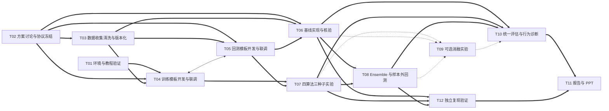

# 基于 FinRL 的强化学习股票交易 Agent 课程项目开发文档

**版本**：v1.2（独立复现任务并强化全员交付责任）  
**项目周期**：4 周，每周一个阶段并预留机动时间  
**团队规模**：6 人研究生小组  
**前置基础**：PyTorch、强化学习基础  
**训练方式**：本地与云算力（AutoDL 等）结合  
**核心目标**：完成从 DRL 形式化、FinRL 环境使用、四算法三种子训练、简化 Ensemble 到统一回测与评估的闭环；不以追求收益为目标，重点服务对强化学习算法、MDP 设计、模型选择和评估局限的理解。

---

## 1. 问题说明：基于强化学习的股票交易 Agent

### 1.1 问题定义

股票交易是典型序贯决策问题：Agent 在每个时间步观察市场状态，决定买入、卖出或持有，并根据交易后的组合价值变化获得奖励。目标是在交易成本、流动性和风险约束下学习策略，使长期累积奖励最大化或风险调整收益最大化。

可形式化为马尔可夫决策过程（MDP）：

- **状态空间 \(S\)**：账户余额、持股数量、价格、成交量、MACD、RSI、布林带等技术指标；本项目以实际选用的日频数据和环境实现为准。
- **动作空间 \(A\)**：离散买卖/持有及股数，如 \(\{-k,\ldots,-1,0,1,\ldots,k\}\)，其中负数、0、正数分别表示卖出、持有、买入。
- **奖励函数 \(R\)**：组合价值变化、对数收益，或用户自定义的含风险/交易成本项的奖励；最终以冻结的环境规格为准。
- **交易约束**：交易成本、买卖价差、市场流动性和风险约束。金融动荡指数 turbulence 若用于交易控制，应明确为风险门控机制，不与普通技术指标混为一谈。
- **策略目标**：学习策略 \(\pi(a|s)\)，在高度随机、复杂的市场中做出动态交易决策。

技术指标只是历史信息的压缩表示，项目不假设金融市场严格满足马尔可夫性，也不预设 DRL 一定优于传统方法。

### 1.2 为什么适合强化学习

- 股票交易是动态、序贯、交互式决策，而非单步预测。
- DRL 通过“探索—利用”平衡，可在未知环境中学习策略。
- DRL 能处理多因子、多资产和非线性关系，适合比较不同状态、动作和奖励设计。
- 课程项目重点在于理解 MDP 建模、on-policy 与 off-policy 算法差异、基于验证集的模型选择，以及回测评估的局限。

### 1.3 课程项目中的问题边界

本项目不追求构建可实盘盈利系统，也不做大规模超参搜索或高频交易。项目要求：

- 使用公开历史数据，本地缓存并可复现；
- 使用 FinRL 提供的标准环境和 Stable Baselines3 算法实现；
- 在统一实验协议下完成四算法三种子对比和简化 Ensemble；
- 报告多种子描述性统计、市场阶段或压力案例、行为诊断和评估局限；
- 保留失败案例和负面结果，不根据短样本回测声称稳定 alpha；
- 所有成员能解释 MDP 设计、算法差异、Ensemble 选优逻辑和指标含义。

---

## 2. 项目说明

### 2.1 项目目标

基于 FinRL 库设计并实现一个强化学习股票交易 Agent，作为深度强化学习课程集体项目。项目需在 1 个月内由 6 人小组完成，成果包括：

1. 可复现的本地与云端数据、训练、验证和回测项目材料；
2. PPO、DDPG、TD3、SAC 四套算法各 3 个随机种子的训练与回测结果；
3. 一个仿照原论文验证集 Sharpe 选优思想的简化 Ensemble 及样本外结果；
4. 同股票池等权、市场指数等基线与统一指标汇总；
5. 三种子描述性统计、市场阶段或压力案例和交易行为诊断；
6. 一份包含 MDP 定义、算法对比、Ensemble、统计分析与局限讨论的报告及 PPT。

可选扩展包括小规模消融和动态滚动重训，不作为核心验收条件。

### 2.2 框架选型：选择 FinRL

本项目选择 **FinRL**，主要基于以下特点及课程适配性：

- 提供环境层、智能体层和应用层组成的完整 DRL 交易流程，便于理解状态、动作、奖励与交易策略之间的关系。
- 支持 PPO、DDPG、TD3、SAC 等本项目所需算法，并提供 Stable Baselines3 接口，可减少重复实现算法的工程量。
- 包含数据处理、训练、验证、回测和基线比较所需的基础组件，适合开展统一协议下的教学实验。
- 教程和示例较完整，便于六人小组共享训练与回测模板，在四周内完成可复现闭环。
- 研究原型定位与项目“重学习、统一评估、不追求实盘部署”的目标一致，便于保留负面结果并分析回测局限。

### 2.3 教程入口与数据方案讨论

#### 2.3.1 教程复现入口

第一阶段使用 FinRL 0.3.8 仓库实际提供的三个 Python 脚本，而不是旧计划所述的三连 Notebook：

1. 数据处理脚本：数据下载、指标与风险变量处理、数据划分；
2. 训练脚本：训练并保存智能体；
3. 回测脚本：回测并与基线比较。

教程只用于环境验证和流程复现。主实验的数据市场、时间区间和模型配置须在第一阶段讨论并冻结。

#### 2.3.2 主实验数据二选一

| 方案 | 数据与基线 | 优势 | 重点检查 |
| --- | --- | --- | --- |
| DOW30 | 优先 Yahoo Finance；DJIA 与同股票池等权买入持有为基线，MVO 可选 | 与教程衔接直接，适配成本较低 | 成分股口径、缓存完整性、复权、幸存者偏差 |
| CSI50 | 使用经本组验证的中国证券数据源；同池等权与对应市场指数为基线 | 可比较中国市场，避免完全沿用教程 | 第一阶段核实指数名称、代码和成分股；数据源字段、复权、交易日对齐、股票池时点及 FinRL 适配 |

选择标准包括数据可获得性、字段和环境兼容性、清洗成本、样本长度、市场阶段覆盖及本地/云端训练预算。Baostock 等中国证券数据源不能作为 DOW30 的等价备用源；更换市场或数据源后必须重新验证资产覆盖和基线定义。

若最终缩小股票池，同池等权是主要可比基线，市场指数仅作为外部参照。

#### 2.3.3 时间划分与三个市场阶段

第一阶段必须讨论并记录：候选数据区间是否涵盖上涨、下跌、震荡三个市场阶段，以及这些阶段是否进入样本外测试期。

- 优先选择能支持样本外三阶段分析的较长测试区间，不默认教程的 2026-01-01 至 2026-03-20 短测试期足够。
- 市场阶段依据可事先冻结的指数收益、回撤或波动规则确定，不得在查看策略测试结果后人为贴标签。
- 若保留短测试期或实际数据不支持三个清晰阶段，则改做典型回撤、高波动或基线明显占优的压力案例，并明确说明限制。
- 第一阶段最终冻结无重叠的训练、验证、测试日期。验证集仅用于事先约定的有限配置检查和 Ensemble 选优，测试集不得用于调参、选模或实验设计。

### 2.4 统一实验协议

| 项目 | 约定 |
| --- | --- |
| 资产池与数据 | 第一阶段比较 DOW30/CSI50 并冻结唯一方案；训练和回测只读校验后的本地缓存 |
| 时间划分 | 第一阶段冻结训练/验证/测试区间及市场阶段规则，确保无重叠 |
| 主实验算法 | PPO、DDPG、TD3、SAC |
| 随机种子 | 每算法固定相同 3 个种子，共 12 次完整主实验 |
| 集成策略 | 复用主实验候选模型，按验证期 Sharpe 选优，测试期只执行选定模型 |
| 核心指标 | 期末组合价值、年化收益、年化波动率、最大回撤、Sharpe |
| 补充诊断 | 换手率、动作分布、持仓变化、最大回撤期间行为 |
| 基线 | 同股票池等权买入持有、对应市场指数；MVO 可选 |
| 回测模板 | 数据与回测负责人统一提供，算法负责人不得自行定义指标 |
| 训练模板 | 训练模板负责人统一提供最小 SB3 训练/保存/验证接口 |
| 统计口径 | 逐种子结果、均值±标准差和描述性比较，不作强显著性推断 |
| 复现要求 | 固定种子，保存配置、数据版本、日志、模型和回测结果；接受并解释 DRL 随机性 |
| 可选扩展 | 小规模消融、动态滚动重训、A2C 或额外基线，不影响核心验收 |

第一阶段还需统一收益频率、年化方式、无风险利率、Sharpe 和换手率公式，以及初始资金、交易成本、成交时间、股数取整和不可行动作处理规则。

### 2.5 基线选取与实现

基线用于回答“DRL 相对于简单规则或传统组合方法是否带来额外价值”，不能只保留市场指数一个参照。

- **选取标准**：与主实验资产池和测试区间一致；计算逻辑透明；能够复现；与 DRL 使用相同价格口径、初始资金和评估指标；避免不必要的实现复杂度。
- **核心基线**：同股票池等权买入持有用于衡量资产配置和交易行为的增量，对应市场指数用于提供市场整体表现参照。
- **可选基线**：均值—方差优化（MVO）或最小方差组合，用于补充传统组合配置比较；只有在数据、估计窗口和求解依赖验证可行后纳入。
- **实现要求**：基线与 DRL 共用统一回测和指标接口，明确调仓频率、交易成本、权重计算时点及不可交易资产处理，防止因口径不同产生虚假优势。
- **结果要求**：基线结果与 DRL 结果使用相同样本外区间，保留净值、回撤和换手等诊断；是否跑赢基线不作为项目验收条件。

### 2.6 本地与云算力结合

本地环境用于教程验证、数据清洗、小规模调试和统一回测，AutoDL 等云算力用于耗时较长的并行训练；两端须保持依赖、配置、数据版本和随机种子一致，训练结果及时回传并登记。项目中不采用基于 Jupyter Notebook 的 Google Colab 流程，因为交互式状态和云端会话不利于长任务管理、版本固定与可复现交接，统一脚本更便于本地和云环境复用。

- **环境兼容性**：Python、FinRL、Stable Baselines3、PyTorch 及关键依赖版本以第一阶段实测为准，保存可用环境配置，不预设未经验证的兼容范围。
- **训练预算**：通过一次小规模 PPO 和一次 off-policy pilot 记录实际耗时、内存、数据规模和云端费用，再冻结训练 timesteps 与算力分配。
- **数据稳定性**：优先使用经过校验的本地缓存；云端只读取同一版本数据，替换数据源必须重新检查市场、资产、字段、复权和日期。
- **并行安排**：算法组 A/B 可在本地与云端并行训练，但不得因算力差异改变各算法的训练预算。
- **负面结果**：算法不收敛、Ensemble 跑输单算法或基线均可作为结果报告，不反复使用测试集调参。

---

## 3. 开发流程拆分与任务依赖

完整项目框架需在训练模板和回测模板完成并联调后确定。当前只定义子任务、依赖、交付物类型和角色交接，不预设具体框架图、目录结构或产物文件名。六名组员依次编号为P1-P6。

### 3.1 开发子任务

#### T01 环境与教程验证

- **内容**：配置本地与云端环境，跑通缩短步数的教程流程，验证数据、训练、模型保存和回测链路，记录版本、耗时与常见问题。
- **交付**：可复现环境说明、教程验证记录、本地/云端运行注意事项。

> **待讨论确定**：在 T02 开始前，需讨论 DOW30/CSI50、三个市场阶段、训练/验证/测试边界、交易成本、指标口径、三个种子及本地/云算力分配。讨论只依据数据可得性、研究问题和预算，不查看测试集策略结果。**必须直接参加：P1、P2。**

#### T02 实验方案讨论与协议冻结

- **内容**：由 P1、P2 共同确定数据市场和股票池；判断样本外区间能否覆盖上涨、下跌、震荡三个市场阶段；冻结时间划分、环境语义、成本、指标、随机种子、训练预算和结果登记规则。若无法覆盖三个阶段，确定压力案例替代方案。
- **交付**：实验决策记录、统一协议、市场阶段或压力案例规则、算力与训练预算。

#### T03 数据收集清洗与版本化

- **内容**：按 T02 决策收集数据，完成复权、缺失与重复处理、交易日对齐、指标计算和训练/验证/测试切分，检查前视偏差并固定数据版本。
- **交付**：校验后的数据缓存、数据质量报告、数据处理与版本说明。

#### T04 训练模板开发与联调

- **内容**：实现统一配置、种子、训练、验证、模型保存和日志接口，用少量步数验证本地与云端运行一致性，并与数据及回测接口联调。
- **交付**：最小训练模板、验证接口、运行记录和模板交接说明。

#### T05 回测模板开发与联调

- **内容**：实现统一指标、净值与回撤输出、结果登记和行为诊断接口，与训练模板及数据切分联调，检查指标和成交时间口径。
- **交付**：统一回测模板、指标说明、结果登记规范和模板联调记录。

> **待讨论确定**：T06 实现前先确定基线标准，包括同池等权与市场指数是否足够、是否增加 MVO/最小方差、调仓频率、成本口径、权重估计窗口和不可交易资产处理。可选基线不得挤占主实验预算。**必须直接参加：P3、P4。**

#### T06 基线实现与核验

- **内容**：由 P3、P4 共同实现同池等权买入持有和对应市场指数基线，按讨论结论决定是否实现 MVO/最小方差；与 DRL 共用数据、回测和指标接口，核对权重、调仓、成本和样本外区间。
- **交付**：核心基线结果、基线实现说明、口径核验记录和可选基线结果（如有）。

#### T07 四算法三种子训练、验证与回测

- **内容**：算法组 A/B 并行完成 PPO、DDPG、TD3、SAC 各 3 个种子的训练、验证和测试回测，保存所有成功与失败运行，不使用测试集调参。
- **交付**：12 套主实验结果、四种算法说明、训练/验证曲线和完整运行登记。

> **待讨论确定**：T08 前需确认 Ensemble 候选范围、验证期 Sharpe 计算和并列处理规则，并讨论是否实施动态滚动重训。固定验证期一次选优为必做；只有在 12 次主实验和固定 Ensemble 完成、时间与算力允许时，才增加滚动窗口、重训频率和各窗口选优。**必须直接参加：P2、P5。**

#### T08 Ensemble 实现与样本外回测

- **内容**：复用主实验模型，按验证期 Sharpe 完成固定选优，冻结选中模型后进行测试期回测，并与单算法和基线比较；若经讨论启用扩展，再实现动态滚动重训。
- **交付**：Ensemble 选优记录、样本外结果、单算法对比分析，以及动态重训结果（如实施）。

> **待讨论确定**：T09 为可选任务。启动前须讨论消融研究问题、因素与水平、算法和种子、训练预算及停止条件；只有在主实验、固定 Ensemble、核心基线和必需图表完成后才能启动，不设最低完成次数。**必须直接参加：P1、P2、P3、P4。**

#### T09 可选消融实验

- **内容**：从奖励、状态特征或交易成本中选择一个明确因素开展小规模配对实验，使用相同数据和统一评估，结论限定于当前任务与预算。
- **交付**：消融设计记录、实验结果和探索性分析（仅在实际启动时）。

#### T10 统一评估与行为诊断

- **内容**：由 P6 汇总单算法、Ensemble 和基线结果，完成三种子描述性统计、市场阶段或压力案例、换手/持仓/动作诊断及局限分析，P2–P5 提供口径核对和结果解释。
- **交付**：统一指标汇总、对比图表、统计与行为分析、局限说明。

#### T11 报告与 PPT

- **内容**：由 P6 整理报告、PPT、决策记录和最终图表，核对核心与可选交付边界；各成员提供并核对自己部分的内容，不由 P6 代为补做分析。
- **交付**：最终报告、PPT、图表索引和可交接项目材料。

#### T12 独立复现验证

- **内容**：由 P5 组织独立复现，依据冻结配置、数据版本和运行说明抽查主实验、基线与 Ensemble 在本地或云端的可复现性；汇总各成员自测记录，定位并反馈差异。
- **交付**：独立复现记录、差异与问题清单、修复后的复现结论。

### 3.2 全员分析与复现责任

T10、T11、T12 由指定成员主责，但不等于由主责人单独完成。各成员必须对自己负责的任务提供以下材料并承担交接责任：

- **原始数据**：保留可重新计算的原始结果、数据版本、配置和运行日志，不只提交截图或汇总均值。
- **绘图程序及表格**：提交生成图表的程序、输入数据和对应表格，保证 P6 能复画、P5 能核对，图表与结果来源一致。
- **自己部分的初步分析**：说明实验设置、主要现象、异常与负面结果、原因假设和局限，按时提交给 T10/T11，不把数据解释全部转交 P6。
- **自测复现**：交接前按运行说明从配置和数据重新执行关键流程，记录环境、命令、输出及差异；P5 的独立抽查不能替代各成员的自测复现。
- **问题修复**：收到 T10 的口径问题或 T12 的复现差异后，原任务负责人须及时核查并修复，P5、P6 负责组织和验收，不负责替他人重建缺失材料。

### 3.3 子任务有向无环图

粗实线箭头表示前后置依赖，双箭头表示 T04/T05 并行交互联调，点线表示可选消融的启动或结果路径；T11 最终报告同时依赖统一分析和独立复现结论。

T04 与 T05 可在统一接口约定下并行开发，联调通过后才向算法、基线和 Ensemble 角色交接；T09 不阻塞核心链路。

---

## 4. 角色归属与四周阶段安排

### 4.1 子任务归属

采用“主责角色 + 协作角色 + 全员共享理解”模式，六名组员依次编号为 P1–P6。训练模板由 P1 独立负责，数据收集清洗和回测框架集中由 P2 负责；P3、P4 各负责两种算法。

| 编号 | 角色 | 主责子任务 | 协作与交接职责 |
| --- | --- | --- | --- |
| P1 | 训练模板 | T01、T02（与 P2 共同）、T04 | 向算法组交接训练/验证接口；支持本地与云端环境一致性和 T12 复现；按 3.2 提供分析与自测材料 |
| P2 | 数据收集清洗 + 回测框架 | T02（与 P1 共同）、T03、T05 | 交接数据版本与回测接口；支持 T06、T10 和 T12 的数据/指标核查；按 3.2 提供分析与自测材料 |
| P3 | 算法组 A | T06（与 P4 共同）、T07 中 PPO、DDPG；T09（如启动，按分工承担） | PPO、DDPG 各完成 3 个种子；提交原始运行、绘图程序、表格、初步分析和自测复现记录，支持 T10–T12 |
| P4 | 算法组 B | T06（与 P3 共同）、T07 中 TD3、SAC；T09（如启动，按分工承担） | TD3、SAC 各完成 3 个种子；提交原始运行、绘图程序、表格、初步分析和自测复现记录，支持 T10–T12 |
| P5 | 集成、回测与独立复现 | T08、T12 | 准备验证结果汇总和选优流程，完成 Ensemble；组织独立复现并汇总全员自测记录，支持 T10/T11 的对应内容 |
| P6 | 汇报 / 报告 / PPT | T10、T11 | 维护材料清单、决策记录和报告结构；组织统一分析、报告和 PPT，不筛选结果，不替其他成员补做初步分析 |

**交接约束**：

- 模板未完成联调前，不批量启动主实验；算法组可并行阅读算法、检查配置和准备小规模调试。
- 两名算法成员使用相同数据、环境、时间区间、成本、训练预算和三个种子，不自行修改指标或删除失败运行。
- P2 交接统一回测与指标口径，P3、P4 交接基线结果后，P5 与 P6 不得另建计算口径。
- Ensemble 只能根据验证期结果选优；测试集结果出来后不得回改候选或选择规则。
- P6 负责 T10/T11 汇总而非单独补做实验，P5 负责 T12 独立抽查而非替代自测；各主责角色必须按 3.2 提供原始数据、绘图程序及表格、初步分析和自测复现记录，并对结果和文字准确性负责。

### 4.2 每周一个阶段（含机动时间）

| 阶段 | 时间 | 子任务与并行安排 | 阶段完成与交接 | 机动时间用途 |
| --- | --- | --- | --- | --- |
| 第一阶段：决策、数据与模板 | 第 1 周 | T01 与 T02 并行启动；T02 决策后推进 T03；T04/T05 在接口约定下并行开发并联调；T06 先讨论基线标准 | 数据与协议冻结，训练/回测模板联调通过，完整项目框架据此确定；向算法、基线和 Ensemble 角色交接 | 约 1 天，处理安装、数据源和模板接口问题 |
| 第二阶段：基线与主实验并行 | 第 2 周 | P3、P4 共同完成 T06 核心基线，并在本地和云端并行推进 T07；P5 准备 T08 和复现检查清单，P6 同步整理材料 | 核心基线可复算；四算法均有有效运行，原则上各完成至少 1 个种子；主实验结果持续登记并交接验证结果 | 约 1 天，处理云端任务、数据或不收敛问题 |
| 第三阶段：主实验收尾与 Ensemble | 第 3 周 | T07 完成剩余种子；T08 在验证结果齐备后完成固定选优与测试回测；P5 对已完成结果启动 T12 抽查；核心完成后再讨论是否启动 T09 | 完成 12 次主实验和固定 Ensemble；各成员提交初步分析、绘图材料与自测记录；动态滚动重训与消融有明确启动/取消记录 | 约 1 天，补跑失败任务、复核选优和修复复现差异 |
| 第四阶段：统一评估与交付 | 第 4 周 | P6 主责 T10/T11，P5 主责 T12 并完成独立复现；各成员并行补充原始数据、绘图程序及表格、初步分析和自测记录，及时修复问题 | 三种子统计、阶段/压力案例、行为诊断和复现记录齐全；报告与复现结论一致，明确核心结果、可选实验和局限 | 约 1 天，修复复现问题、统一口径和演练汇报 |

### 4.3 主实验与 Ensemble 执行口径

- 四算法均使用相同的三个固定种子，每个“算法—种子”组合只对应一个事先登记的主配置。
- 主实验必须报告逐种子指标、均值和标准差，不只报告最佳种子；三个种子不足以支持强显著性结论。
- 固定 Ensemble 复用 12 个主实验候选模型，按验证期 Sharpe 选优，冻结选中模型后进行样本外评估。
- 动态滚动重训属于 T08 的可选扩展，须另行冻结窗口、重训频率和选优规则；未实施时不影响核心验收。
- 若后续要求严格复现原论文的 A2C/PPO/DDPG 候选组合，再将 A2C 单列为扩展。
- T12 由 P5 组织独立抽查，优先检查数据、配置、代码、模型与净值路径的可追溯性；各成员先完成自测复现并提交记录，数值差异按指标和随机性解释。

### 4.4 第一阶段协议冻结清单

第一阶段结束前必须冻结以下内容，后续不得由单个成员擅自修改：

- 数据市场、资产池、股票清单及成分股口径；
- 数据版本、复权、缺失处理、交易日对齐和指标窗口；
- 训练期、验证期、测试期及三个市场阶段或压力案例规则；
- 初始资金、交易成本、成交与时间点对齐规则；
- 状态空间、动作语义、不可行动作处理、奖励公式和 turbulence 使用方式；
- 三个随机种子、本地/云端训练预算和结果登记规则；
- 指标、核心基线、可选基线及各自实现口径；
- Ensemble 候选、验证期 Sharpe、选优和模型冻结规则；
- 可选消融与动态滚动重训的启动条件和讨论时点。

---

## 5. 风险控制与降级规则

| 风险 | 概率 | 应对 |
| --- | --- | --- |
| 环境版本冲突 | 高 | 第一阶段实测并保存可用环境；本地与云端使用一致依赖；记录完整安装命令 |
| 数据下载失败或市场切换不适配 | 中高 | 优先校验后的本地缓存；DOW30/CSI50 不静默互换；更换数据源后重做字段、日期和基线检查 |
| 前视偏差或测试集泄漏 | 中高 | T03/T05 检查特征、信号、成交和净值时间索引；验证与测试隔离；集成选优留痕 |
| 固定股票池带来幸存者偏差 | 中 | 披露成分股时点和限制；不把结果外推为历史全市场有效性 |
| 本地/云端算力不足、训练过慢或环境中断 | 中 | 以 pilot 校准训练预算和云端费用；及时回传模型与日志；算法组错峰并行；先取消可选任务，再缩减预算或股票池并重新冻结协议 |
| 某算法不收敛或表现极差 | 中 | 保留为负面结果；不反复调参或使用测试集 cherry-pick |
| Ensemble 选择波动或跑输基线 | 中 | 报告验证 Sharpe、选中模型和测试表现；区分模型选择收益与真实样本外优势 |
| 测试期不足以覆盖三个市场阶段 | 中 | 第一阶段优先选择更长的样本外区间；若仍不足，改做压力案例并披露，不强行分段 |
| 三种子结果被过度解释 | 中 | 仅作描述性统计，不宣称强显著性或稳定 alpha |
| 分工碎片化 | 中 | 全员跑通教程；统一接口和结果登记；按周交接并在第四阶段核对各模块交付 |

**降级顺序**：

1. 先取消可选消融、动态滚动重训和额外基线，保留固定验证期的简化 Ensemble。
2. 再缩短训练步数或缩小资产池，并重新冻结和记录协议。
3. 三种子是核心要求，不把减少种子列为默认降级；若确需变更，须全组确认并在执行记录和报告中显式说明。
4. 不通过测试集调参、删除失败运行或减少结果披露来维持表面结论。

---

## 6. 工作量估算

核心范围按 12 次主实验、1 个固定 Ensemble、统一数据/回测和报告估算，全组有效投入约 **72–102 人天**；可选消融和动态重训不计入核心工作量。

| 阶段 | 估算有效投入 |
| --- | ---: |
| 第一阶段：决策、数据与模板 | 16–22 人天 |
| 第二阶段：基线与主实验并行 | 18–26 人天 |
| 第三阶段：主实验收尾与 Ensemble | 20–28 人天 |
| 第四阶段：统一评估与交付 | 18–26 人天 |
| **合计** | **72–102 人天** |

最终验收以能解释 MDP、四算法差异、三种子波动、Ensemble 选优、基线对比和评估局限为核心，而不是追求收益。

---

## 7. 最终交付物

具体目录结构和产物文件名在 T04/T05 联调完成后统一确定，当前仅约定交付内容：

1. **可复现项目材料**：环境配置、本地与云端运行说明、数据版本与质量说明、统一协议、训练/验证/回测模板、原始结果、绘图程序及表格、各成员初步分析、自测复现记录和 P5 独立复现结论。
2. **主实验结果**：PPO、DDPG、TD3、SAC 各 3 个种子的 12 套完整结果，四种算法说明及训练、验证和回测曲线。
3. **基线结果**：同池等权、市场指数及经讨论纳入的可选基线，附实现口径和核验记录。
4. **Ensemble 结果**：验证期选优记录、样本外结果、与单算法和基线的对比，以及动态滚动重训结果（如实施）。
5. **统一分析**：三种子描述性统计、市场阶段或压力案例、行为诊断、失败案例、负面结果和评估局限；可选消融仅在实际完成时提交。
6. **课程展示材料**：项目报告、演示 PPT 和最终图表索引。

**最终验收核心**：项目材料完整说明 MDP 设计、四算法差异、三种子结果、Ensemble 验证集选优、基线对比和评估局限，并能从干净环境复现主要结果；是否跑赢市场不作为验收条件。
