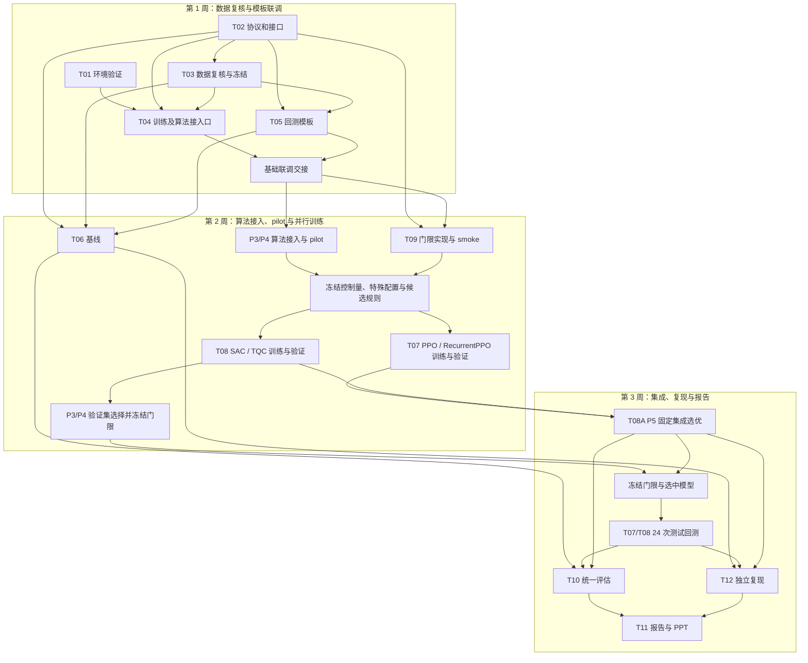

# 基于 FinRL 的强化学习股票交易 Agent 小组项目计划

**版本**：v2.0（循环策略对照与交易拒绝门限）  
**项目周期**：3 周，每周一个阶段并预留机动时间  
**团队规模**：6 人，角色编号 P1–P6  
**前置基础**：PyTorch、强化学习基础  
**训练方式**：本地与云算力结合  
**文档状态**：组内执行计划；数据指纹、算法配置、门限参数及训练预算按下列安排核验和冻结。

本计划以 [v1.2](小组项目计划v1.2.md) 为基础，吸收项目调整建议。v1.2 保留为历史版本。当前数据与回测细节分别见 [SSE48 数据说明](README_sse48_baostock_v2.md) 和 [统一回测框架说明](README_backtest.md)。

---

## 1. 问题与项目边界

### 1.1 问题定义

股票交易是序贯决策问题。智能体观察账户与市场状态，提出买入、卖出或持有动作，并依据组合价值变化获得奖励。本项目使用 FinRL 股票环境研究和比较不同策略。

- **状态**：现金、各资产价格和持仓，以及技术指标；当前 48 股、八项指标口径下为 481 维，以实际冻结配置为准。
- **动作**：模型对每个资产输出连续 Box 动作，当前环境乘以 `hmax` 后向零取整，再按资金、持仓、可交易状态及风险规则执行。整数是复权模拟单位，不是交易所真实股数。
- **奖励**：当前环境使用相邻时点组合价值变化乘以 `reward_scaling`；成交费用已影响账户价值。正式实验以共享环境和冻结配置为准，不擅自为单个算法更改奖励。
- **约束**：模拟包含买卖成本、资金/持仓限制及配置指定的可交易、风险规则；如启用 turbulence，将其作为市场风险门控。

### 1.2 研究问题

1. **记忆对照**：PPO 与 RecurrentPPO 在相同数据、观测、环境和训练协议下，表现和交易行为有何差异？
2. **门限对照**：对同一个已训练 SAC 或 TQC 模型，在推理阶段增加简单动作门限或 Critic 门限后，交易行为和净表现有何变化？Critic 门限是否优于简单规则？
3. **固定集成选优**：复用主实验候选模型，仅根据验证期 Sharpe 选择一个模型，冻结后评估其样本外表现。

第二项是主要创新实验；第一项为补充算法对照。Critic 门限用于推理阶段的策略后处理，固定集成选优采用一次验证集模型选择。

### 1.3 范围和不做事项

- 以统一回测中的策略比较为目标，保留失败和负面结果。
- DDPG、TD3 移出必做，但保留已有代码和结果；A2C 门限的重新设计与实验暂不实施。
- 本轮开展数据质量检查，数据扰动训练与可靠性门控暂不纳入。
- 动态滚动重训、MVO/最小方差和进一步门限研究为可选，只有核心工作及资源允许时启动。

---

## 2. 当前进展与数据基础

### 2.1 当前进展快照

以下为 `train_module` 分支的本机工作区和历史报告快照；各成员交接时补充其他机器上的进展。

| 项目 | 当前状态 | 下一步 |
| --- | --- | --- |
| 数据 | 数据说明已记录清洗、指纹、指标和日期核验；本机存在训练、验证、测试 CSV 及对应指数文件 | P2 复核并冻结数据契约，P1 核验文件、身份、顺序及哈希；其他机器分别核验 |
| 训练与回测 | 训练模板、共享环境和统一回测接口可复用；现有文档记录账户对账及版本检查 | P1/P2 按 v2.0 扩展接口并重新联调 |
| 历史 smoke | 本机报告记录原四算法各单种子 128 步训练、485 日验证回放，以及合成数据 PPO 64 步回放通过 | 在此基础上开展 v2.0 算法和接口验证 |
| 新算法与门限 | 项目训练白名单和回测加载映射为 PPO、DDPG、TD3、SAC；FinRL 原始模型表另含 A2C。权威锁文件未列出 `sb3-contrib` | 扩展项目接口并验证 RecurrentPPO、TQC、简单门限和 Critic 门限 |
| 选优与基线 | FinRL 原有 Ensemble 为动态滚动重训选优，不等同于本计划的一次固定验证集选优；P2 回测支持外部基线输入。固定选优和同池等权正式结果尚未核实 | P5 实现固定选优；P3/P4 交付同池等权，P2 核验 |
| 正式实验 | 当前工作区尚无 SSE48 正式训练模型及对应训练结果目录 | 核验其他成员交付并统一登记正式结果 |

数据、训练模型和运行产物按仓库规则保存在本地；交接时须核对来源与哈希，不能仅依赖本机路径。

### 2.2 数据版本与时间划分

主实验使用 `sse48_baostock_v2` 候选数据，验证失败时按变更流程重新决策。该数据使用 BaoStock 行情、交易状态和复权因子，股票池为 2016 年初上证 50 名单排除两只后的固定 48 股。八项技术指标在本地计算；股票名单、数据来源和指纹见相关配置与数据说明。

| 子集 | 已有数据说明中的实际交易日 | 用途 |
| --- | --- | --- |
| 训练 | 2017-01-16 至 2020-12-31 | 模型训练，包含指标预热后的数据 |
| 验证 | 2021-01-04 至 2022-12-30 | 有限配置检查、门限选择、固定集成选优 |
| 测试 | 2023-01-03 至 2026-11-03 | 参数和选中模型冻结后的最终样本外评价 |

P2 核验实际文件、日期、哈希和供应商修订并发布数据契约，P1 在正式运行前核验。训练、验证和测试保持独立；测试绩效仅用于最终评价。

市场阶段采用数据配置中既有的指数 60 日收益、上下 5% 阈值和连续 20 个交易日规则，正式实验前由 P2 核验并冻结。若实际测试区间不足以支持某阶段的连续分析，改报告预先登记的压力案例，不根据策略测试结果重贴标签。

### 2.3 共享环境与限制

训练和回测复用同一共享环境、股票及指标顺序、复权价格、初始资金、交易成本、`tradable` 策略和风险阈值。P2 发布环境和回测契约；P1、P3、P4 按契约使用。`hmax` 和 turbulence 阈值以正式冻结配置为准。

当前回测以同日复权收盘信息决策并按同收盘价成交、下一日估值，报告中须说明其可能偏乐观，并列明 T+1、涨跌停排队、整手、滑点和公司行为结算等未模拟的交易限制。

---

## 3. 统一实验协议

### 3.1 模型与条件

| 条件 | 训练模型 | 推理执行 | 目的 |
| --- | --- | --- | --- |
| P0 | PPO | 无门限 | 普通 PPO 基线 |
| P1 | RecurrentPPO | 无门限 | 比较循环记忆；此处 P1 是实验条件，不是成员编号 |
| S0 | SAC | 无门限 | SAC 基线 |
| S1 | 与 S0 同一 SAC 模型 | 简单动作门限 | 简单过滤对照 |
| S2 | 与 S0 同一 SAC 模型 | Critic 门限 | 门限实验 |
| T0 | TQC | 无门限 | TQC 基线 |
| T1 | 与 T0 同一 TQC 模型 | 简单动作门限 | 简单过滤对照 |
| T2 | 与 T0 同一 TQC 模型 | Critic 门限 | 门限实验 |

- 四算法使用相同三个预先冻结的种子，共 **12 次正式训练**；每个“算法—种子”只有一个事先登记的主配置。
- 固定测试集共 **8 个条件 × 3 种子 = 24 次策略回测**。S0/S1/S2 和 T0/T1/T2 各自复用同算法、同种子、同一模型文件，仅改变推理规则，不重新训练。
- 集成选优不新增训练，选中模型的无门限测试结果复用 24 次之一，不额外计数；独立重跑另行登记。验证集候选回测、pilot、失败重试、非 DRL 基线及独立复现均不计入 24 次。
- 模型及条件使用相同数据、环境、成本、时间边界和预先冻结的交互步数预算。PPO 类 rollout 可能使实际步数超过请求值；记录实际步数、设备、耗时和资源，不假设不同算法计算成本相同。
- 门限改变交易后，后续持仓和状态也会改变；这是同模型配对回测，不是逐日相同状态的反事实比较。

P3、P4 共同确定并登记控制量，包括数据、环境、成本、三个种子和交互步数预算；分别确定各自负责算法的特殊训练超参数及门限参数。P3 负责 PPO、RecurrentPPO 和简单门限，P4 负责 SAC、TQC 和 Critic 门限。各算法的特殊配置及其差异须在正式训练前记录并冻结；共享的简单门限由 P3/P4 按统一选择规则确认。训练配置校验改为按当次启动的算法检查，不要求每份配置同时包含全部算法。

### 3.2 简单动作幅度门限

由 P1 先发布版本化接口，P3 实现并自测，P2 接入统一回测。对每个资产，沿用环境相同的数据类型和计算路径，计算 `q_i = trunc(a_i * hmax)`：若 `abs(q_i) < q_min`，则将该资产动作置零，否则保留原动作。`trunc` 为向零取整；`q_min=1` 不增加实质过滤，因为原环境已将不足一个模拟单位的动作取整为零。

候选 `q_min ∈ {2, 5, 10}` 作为制定选择协议的起点。P3 确定候选范围及实现，P3/P4 共同确定统一验证指标、并列与无效值处理规则，P2 核验指标。SAC/TQC 共用的简单门限由 P3/P4 按登记规则在验证集选择；正式规则在训练前登记。

门限逐资产执行，环境仍最终处理资金、持仓、停牌和风险强平；不能以门限屏蔽强制风险规则。临界值和负动作须按真实浮点及取整路径测试。

### 3.3 Critic 门限

由 P1 发布输入输出及动作坐标等接口，P4 按契约实现 SAC/TQC 门限，P2 接入回测。门限仅在推理时使用：以相同状态、相同动作尺度和相同摘要规则比较策略动作 `a` 与零动作 `0`：

`delta = summary(s, a) - summary(s, 0)`。

最小方案对两侧使用相同汇总规则：SAC 使用预先定义的标量 Critic 摘要，TQC 使用预先定义的分位数均值摘要；当 `delta` 不超过冻结阈值时拒绝完整动作向量。P4 在正式训练前登记摘要、候选范围、相等边界、禁用行为及无效数值处理，并在验证集选择最终阈值；SAC 和 TQC 不要求阈值数值相同。

- Critic 门限拒绝整向量，简单门限逐资产过滤；分析时结合两者作用粒度的差异。
- 两侧动作采用相同的预处理和 Critic 聚合；分析时关注零动作的数据覆盖及 Critic 估计误差。
- 当前奖励已反映成本，阈值受奖励缩放和回报尺度影响；风险规则可能覆盖零动作并产生实际成交。
- Critic 分歧、分布距离、逐资产反事实门限及训练时启用门限属于可选研究，不属于本轮最小实现。训练期门限涉及探索、经验回放及记录动作一致性，需另订协议。

### 3.4 验证选择与测试隔离

正式训练前，P3/P4 确定并版本化门限候选、选择指标、并列和无效结果规则；P2 提供统一指标契约，P5 留存选择记录。候选数应有限；验证指标为 Sharpe 时，收益区间不足或波动为零导致的 `null` 不能当作零，须按预先登记规则处理。

第 2 周正式模型训练完成后，P3/P4 在验证集执行已登记的候选选择，分别冻结简单门限及 SAC/TQC Critic 门限。记录所有候选和结果、选择规则、模型/数据哈希及最终参数；无法按规则选出时登记失败，不使用测试集补选。所有策略测试回测开始前，门限及第 3.5 节选中模型必须冻结。不得使用测试结果修改参数、候选、种子或实验设计。

### 3.5 P5 固定验证集集成选优

P5 主责一次固定验证集选优：

1. 复用 PPO、RecurrentPPO、SAC、TQC 的 **12 个无门限正式模型**，即 P0、P1、S0、T0 各三个种子；不把门限变体额外计为候选。候选完整性及版本按正式协议核验。
2. 使用相同验证数据和 P2 统一 Sharpe 口径，按预先登记的有效值、并列与无效结果规则选出一个模型。保存所有候选、种子、验证指标、模型/数据哈希及选择原因；候选缺失或无法按规则选出时登记失败，不根据测试表现补选。
3. 在任何策略测试回测前冻结选中模型，复用其 24 次主回测中的无门限结果；完全相同配置下为复现重跑时另行登记。
4. 与单算法逐种子结果及非 DRL 基线比较，报告选中模型的一条测试轨迹，并说明跨算法及种子选优的验证集选择偏差。

动态滚动重训为可选，实施前冻结窗口、候选和选优规则。

### 3.6 非 DRL 基线与指标

- **核心基线**：同池等权买入持有，明确初始建仓、成本、停牌和未成交现金处理；与策略使用相同测试区间及统一指标。
- **外部参照**：上证 50 指数 `sh.000016`。其价格指数不含分红再投资、不扣策略交易费用，且与固定 48 股池并不完全等价，应单独披露。
- **可选基线**：MVO 或最小方差；须事先冻结估计窗口、调仓、费用和约束，不能挤占核心实验。

P3/P4 交付同池等权基线，P2 核验口径并提供指数及统一评价接口。核心指标为期末资产、累计和年化收益、年化波动、最大回撤和 Sharpe；补充诊断包括成交次数、累计费用、`gross_turnover`、持仓、风险暴露及门限拒绝比例。沿用 P2 定义：`gross_turnover` 为累计买卖成交金额除以初始资本，不能与其他换手定义混用。

---

## 4. 开发方式、接口和依赖

### 4.1 上游契约与下游实现

减少例行共同讨论，采用“**上游先发布契约，下游实现、自测和异步反馈**”的方式：

| 上游负责人 | 发布的契约 | 下游责任 |
| --- | --- | --- |
| P2 | 数据身份与哈希、共享环境、成交及回测指标口径 | P1 训练接口、P3/P4 基线与门限、P5/P6 结果消费均遵守 |
| P1 | 新算法及门限的训练/验证/模型调用接入口、条件身份、异常行为 | P3/P4 接入各自算法、实现门限并确定训练超参与门限参数；P2 按契约接入回测 |
| P2 | 验证期账户曲线与 Sharpe 等统一指标输出 | P5 实现固定集成选优；P6 汇总，不另造指标口径 |

P1 的门限接口定义动作坐标、资产顺序、数据类型和维度、条件标识、原始动作/门限后动作/环境请求/实际成交、未实现与错误行为、风险规则优先级及参数冻结时点。

P1 提供新算法和门限的公共接入口及参数透传，不代 P3/P4 决定算法超参数或门限参数。P3/P4 共同登记控制量，分别登记所负责算法的特殊量；P2 核验与数据、环境及回测口径的一致性。

负责人先自测并提交结果，下游通过问题记录异步反馈；上游修订版本并通知受影响成员。数据口径、实验预算、门限选择规则或已冻结协议发生冲突时，升级处理并重新冻结。

### 4.2 依赖、训练和回测接口

- `requirements-lock.txt` 已固定 Windows/Python 3.9.13、`stable_baselines3==2.7.1`、`sb3_contrib==2.7.1` 与 `torch==2.8.0+cu126` 并完成本地环境实测；计划使用的云端环境在启动前须完成同等依赖与运行核验。接口细节见 [P1 与 P2 回测交接契约](P1_P2_回测交接契约_v1.md) 与 [P1 接口契约](P1_接口契约_v1.md)。
- P1 提供算法注册、白名单、配置校验、模型命名、策略/参数透传及依赖记录的公共接入口，保留旧算法与配置兼容。校验按当次启动的算法检查，支持 P3/P4 分别交付配置。
- P1 的训练、验证和回测接入口支持传递并重置循环状态，PPO 与 RecurrentPPO 均按 on-policy 模型加载。P3 接入 RecurrentPPO 策略并验证其状态行为，P4 接入 TQC 并验证其加载与推理行为。
- P2 扩展回测加载、条件身份和汇总；记录模型原动作、门限后动作、拒绝决定、请求模拟单位、实际成交和风险覆盖原因。条件及冻结参数参与分组，但同条件重复运行不得作为额外种子。
- 清单记录模型/数据/环境/门限实现哈希、算法、种子、配置、设备、依赖、验证和测试边界；选优记录关联候选与测试结果。改变共享环境源码时遵循现有环境哈希契约，不绕过校验静默回放旧模型。
- 本地与云端分别验证依赖、设备和结果，pilot 记录实际步数、耗时、内存及费用；云端不可用时登记阻塞。

### 4.3 三个联调关口

1. **第 1 周基础联调交接**：P1 交付新算法、门限接入口及参数透传，P2 完成现有模板回放与对账，数据和接口契约交接 P3/P4。
2. **第 2 周正式训练关口**：P3/P4 完成各自算法接入、门限实现、smoke 和 pilot，P2 完成相关回放、条件日志与对账；共同控制量、各算法特殊超参数、候选门限、验证选择规则和预算登记冻结后，启动三种子正式训练。训练完成后按验证规则选择最终门限。
3. **第 3 周测试回测关口**：P5 完成固定集成选优并冻结选中模型；门限与选中模型均冻结后，执行 24 次策略测试回测。

---

## 5. 开发任务、交付与职责

| 任务 | 工作内容与交付 | 主责 / 协作 |
| --- | --- | --- |
| T01 环境验证 | 本地/云端依赖、设备、安装及短流程；兼容记录 | P1 验证基础依赖；P3/P4 在第 2 周验证各自算法 smoke |
| T02 协议和接口 | 发布数据与公共接口契约，登记控制量、特殊配置、门限选择规则和阻塞 | P1 发布接入口，P2 发布数据/回测；P3/P4 确定实验参数，P5 留存选优记录 |
| T03 数据 | 复核并冻结 SSE48 数据、哈希、时序、资产身份与指数 | P2；P1 按契约核验 |
| T04 训练模板 | 提供算法接入口、配置透传、保存/加载及验证接口；接入并验证新算法 | P1 公共接口；P3/P4 接入各自算法，P2 配合回测 |
| T05 回测模板 | 条件身份、门限接入、LSTM 回放、对账、指标和汇总 | P2；P1/P3/P4 按契约交付 |
| T06 基线 | 同池等权买入持有及指数接入、口径与结果核验 | P3/P4；P2 核验 |
| T07 记忆组 | 接入循环策略、确定配置与 pilot，完成 PPO、RecurrentPPO 各三种子训练、验证、测试及分析 | P3；P1/P2 联调 |
| T08 门限组 | 接入 TQC、确定配置与 pilot，完成 SAC、TQC 各三种子及三条件配对回测和分析 | P4；P1/P2 联调 |
| T09 门限实现 | 确定候选及选择规则，实现两类门限、测试并在验证集选定参数 | P3 简单门限；P4 Critic 门限；P2 核验，P5 留存记录 |
| T08A 固定集成选优 | 12 个无门限候选验证期 Sharpe 选优、冻结与样本外结果 | P5；P1/P2 核验模型与指标，P3/P4 交接候选 |
| T10 统一评估 | 逐种子、配对、阶段/压力案例和交易行为汇总 | P6；P2–P5 核对 |
| T11 报告与 PPT | 研究问题、实验、结果、创新边界及局限 | P6；全员提供和核对材料 |
| T12 独立复现 | 抽查数据、模型、门限配对、固定选优和结果来源 | P5；各成员先自测，P2 或其他成员交叉核验 P5 选优 |

各任务由表中主责人组织交付，协作人按接口与验收要求提供支持。

### 5.1 任务依赖和交接

以下节点图按三周安排组织任务。第 2 周完成算法接入、pilot、参数冻结、并行训练和门限选择；第 3 周先完成固定集成选优，再与已冻结门限一起进入测试回测。

箭头表示交接或前置依赖。T04/T05 在接口约定下并行开发并联调；基线可并行推进，T10 和 T12 分别汇总分析及复现结论，供 T11 使用。

P3/P4 各自负责从训练到分析的实验交接；P2 统一回测口径，冻结后的候选和规则保持不变。

### 5.2 全员责任

各成员须提交可重新计算的原始结果、数据及配置版本、运行日志、绘图程序与表格、本人初步分析、失败案例和自测复现记录；收到口径或复现问题后由原负责人修复。P5 独立抽查不能代替自测；P6 汇总时不得筛掉负面结果。

---

## 6. 三周进度与阶段验收

| 阶段 | 主要工作 | 阶段交付与机动 |
| --- | --- | --- |
| 第 1 周：数据复核与模板联调 | P2 复核并冻结数据，发布数据与回测契约；P1 发布训练与门限接口契约，提供新算法及门限接入口并验证基础依赖；P2 联调现有回测模板 | 数据与公共接口交接，现有模板回放与账户对账通过；预留机动时间处理兼容问题 |
| 第 2 周：算法接入、pilot 与并行训练 | P3/P4 接入各自新算法、实现门限并开展 smoke 和 pilot；共同确定控制量，分别确定算法特殊超参及门限候选和规则，冻结后并行开展三种子训练与验证；训练完成后按验证规则选择门限。P3/P4 交付同池等权基线，P2 核验；P5 准备选优和复现清单 | 正式训练关口通过，完成 12 次正式训练、验证结果及门限选择记录交接；登记实际步数、耗时、内存、费用和失败运行，预留机动时间补跑 |
| 第 3 周：集成、测试、复现与总结报告 | P5 先完成固定集成选优并冻结选中模型；门限和选中模型均冻结后执行 24 次测试回测；P5 组织独立复现，P6 汇总结果、报告与 PPT | 选优及门限冻结记录、测试回测、基线比较、配对分析、图表、各成员自测及独立复现齐全；预留机动时间修复问题和汇报演练 |

第 2 周正式训练前通过 pilot 测量训练资源与耗时，估算人天及云端费用，并由 P3/P4 冻结共同控制量和各算法特殊配置。依赖、接口或门限未通过关口时，记录阻塞并调整阶段安排。

---

## 7. 评估、验收与风险控制

### 7.1 统一评估与测试

- 报告各算法、各条件逐种子结果与均值±标准差；门限组报告同模型逐种子配对差值、拒绝比例和交易行为。三个种子仅支持描述性比较，不作强显著性推断。
- 分别比较 Critic 门限、简单门限与无门限；披露逐资产过滤和整向量拒绝的差异。单独报告固定选优的候选、验证指标、选中模型及一条测试轨迹，不把复用结果当成新训练种子。
- 使用统一资产、成本、指标和样本外区间比较同池等权与指数。市场阶段规则事先冻结；现有阶段条件连乘并非独立连续策略，不据此计算阶段最大回撤或 CAGR。
- 最低测试包括：门限关闭与原回测一致、`q_min=1` 不改变实际请求、边界及负动作取整一致、Critic 两侧同摘要且零动作差值符合定义、停牌与强平不被绕过、LSTM 状态传递/重置、模型重载、轨迹对齐、选优候选/并列/无效值记录及账户对账。

### 7.2 风险与降级

| 风险 | 应对 |
| --- | --- |
| 依赖冲突或新算法无法联调 | 保留失败信息；不得静默替换算法或升级核心依赖；必要时重新冻结方案 |
| LSTM 状态错误 | 通过训练验证和回测两路径的多步/重置测试，失败时阻断相应实验 |
| Critic 估计不可靠或过度拒绝 | 报告拒绝率、现金/持仓、交易成本和净收益；不将分歧解释为已校准概率 |
| 前视偏差、测试泄漏或幸存者偏差 | 核验时间索引、数据/环境哈希和固定成分股口径；测试结果不得用于选择 |
| 集成选优偏差或跑输基线 | 报告全部候选验证指标、选中模型及测试表现，披露跨算法/种子选择偏差 |
| 算力不足或中断 | 记录 pilot、费用及失败运行，按下述顺序降级，不删结果 |

降级顺序：先取消可选动态滚动重训、MVO 和额外门限研究，保留必做固定集成选优；再经团队确认可取消 TQC Critic 门限，保留无门限与简单门限对照并标记创新实验未完成。进一步缩短步数或缩小资产池须重新冻结；减少三个种子不是默认降级。候选或验证结果不满足集成选优要求时登记未完成，不使用测试集补选，也不按完整实验验收。

---

## 8. 最终交付与验收

1. **可复现材料**：冻结协议、数据版本与质量报告、依赖锁定、本地/云端运行说明、版本化接口、代码及测试。
2. **训练结果**：PPO、RecurrentPPO、SAC、TQC 各三个种子的 12 个正式模型、配置、日志、实际预算与失败记录。
3. **门限与回测**：八个条件的逐种子结果、验证集阈值候选与冻结记录、24 次测试回测清单及门限/交易行为诊断。
4. **固定集成选优**：P5 的 12 个无门限候选、验证期 Sharpe、选中模型冻结、复用的样本外结果和交叉核验记录。
5. **基线与统一分析**：同池等权、市场指数、统一指标、配对结果、市场阶段或压力案例、图表生成程序、各成员初步分析和局限。
6. **复现与展示**：各成员自测、P5 独立复现及选优交叉核验、最终报告、PPT 和图表索引。

验收重点是数据与环境口径一致、实验可追溯，能够解释 MDP、算法差异、LSTM 状态、门限和验证集选优，并完整呈现结果。按降级规则调整的任务须在交付中标明完成情况。

### 8.1 正式启动前冻结清单

- [ ] P2 发布并核验数据、股票及指标顺序、哈希、日期、复权和可交易规则。
- [ ] P1 发布训练/预测/门限接口版本。
- [ ] 本地与计划使用的云端依赖已验证；第 2 周正式训练前，四算法基础 smoke、LSTM 状态、门限 smoke 和 P2 对账通过。
- [ ] P3/P4 共同确定三个种子、请求步数等控制量，分别确定算法特殊超参数，并依据 pilot 冻结配置和资源预算。
- [ ] P3/P4 登记候选门限、摘要、验证指标及并列/无效结果规则；固定集成选优候选与完整性规则已登记。最终阈值在第 2 周验证后冻结，选中模型在测试回测前冻结。
