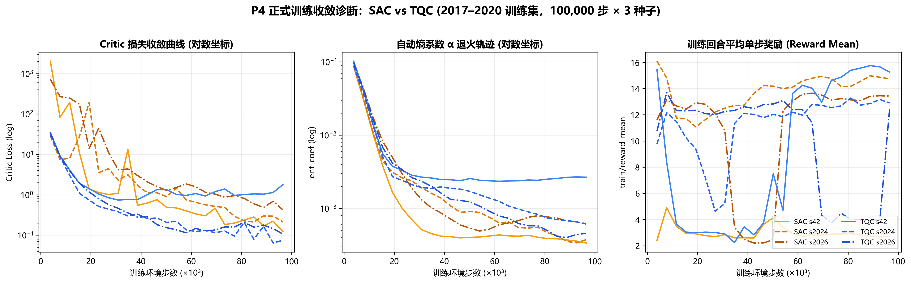
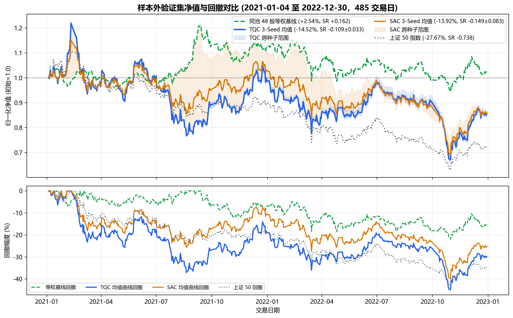
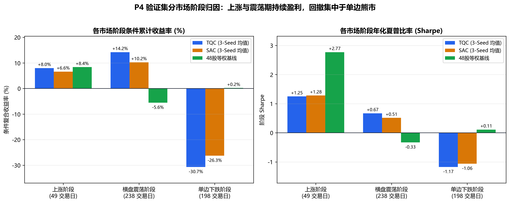
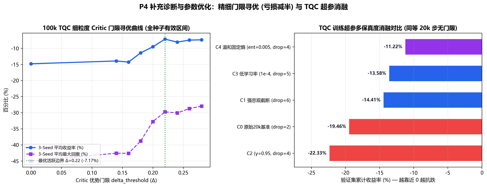

# P4（门限组：SAC / TQC 与推理期 Critic 门限）第一阶段归档交付包

**负责角色**：P4（门限组）  
**归档分支**：`P4`  
**数据与环境指纹**：
- 数据集 `sse48_baostock_v2`：`train_data.csv` (`ee0c2ec0...`)、`val_data.csv` (`2a4d08b6...`) 与 P2 发布快照 100% 一致；
- 共享环境哈希：`shared_environment = 1533394fc3ea7c295765df25b3782f676766537f6ec87922d681a19de6525ce9`；
- 门限实现哈希：`threshold_implementation_sha256 = 8b16ca4cc142f223781ffaccd92784f4288dcccce3a4e38645dc2d93be2d0d74`；
- **测试集严格隔离声明**：本归档仅包含训练集（2017–2020）与验证集（2021–2022）产物，**未触碰测试集 `trade_data.csv`**（正式测试集 `S0/S1/S2`、`T0/T1/T2` 共 18 次配对回测待 P3 合入 `simple` 门限且 P5 完成 12 模型固定选优冻结后执行）。

---

## 目录结构说明（对应五类归档内容）

| 子目录 | 归档类别 | 核心内容说明 |
| --- | --- | --- |
| `01_trained_models/` | **已训练模型** | `sac/` 与 `tqc/` 各 3 个预冻结种子（`42, 2024, 2026`）共 **6 个 100,000 步正式 `.zip` 模型**（内含 `metadata.txt`，直接供 P5 固定集成选优消费），另附 `pilot_20k/` 两个 20,000 步标定模型 |
| `02_training_data/` | **训练数据** | `dataset_splits/`（训练/验证集 CSV 与清单）、`training_runs/`（各次运行 `run_manifest.json`、配置、验证集轨迹及中断失败留痕）、`training_progress_logs/`（6 个正式模型逐轮 `progress.csv` 及合并总表 `all_formal_6models_progress.csv`） |
| `03_backtest_data/` | **回测数据** | `formal_validation/`（30 次验证集配对回测完整目录、`formal_validation_summary.csv`、`sac/tqc_selection_record.json`）、`equal_weight_baseline/`（同池 48 股等权基线）、`pilot_critic_scans/`（Pilot 分位数扫描）、`ablation_optimization/`（补充精细门限与超参消融数据） |
| `04_figures/` | **图表** | `summary_charts/`（4 张 300 DPI 高清汇总对比图，可直接插入报告与 PPT）及 `per_run_curves/`（按条件规范命名的净值与回撤图） |
| `05_preliminary_analysis/` | **初步分析** | 正式交接报告、参数优化与“首日现金吸引子”消融分析、SAC/TQC 算法与手写对照说明、等权基线说明 |
| `manifest_sha256.json` | **完整性校验** | 本归档包内全部文件的相对路径、字节大小与 SHA256 校验清单 |

---

## 核心图表快速预览

### 1. 正式训练收敛曲线（SAC vs TQC，100,000 步 × 3 种子）

### 2. 样本外验证集净值与回撤对比（2021–2022 熊市，485 交易日）

### 3. 分市场阶段收益与夏普归因（上涨 / 震荡 / 下跌）

### 4. 补充诊断：细粒度 Critic 门限寻优与 TQC 超参消融

